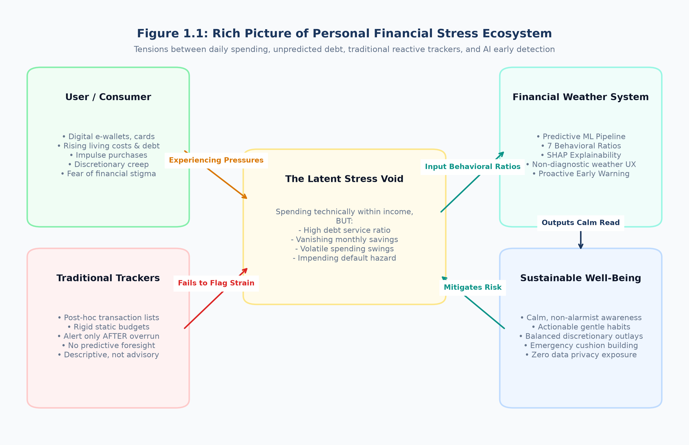

# 1 INTRODUCTION

## 1.1 Chapter Overview
This introductory chapter establishes the academic and technological foundation for the research project titled **"An Intelligent Financial Stress Detection System Using User Spending Behavior"**, manifested practically as the software platform **"Financial Weather"**. The chapter investigates the complex socioeconomic reality of personal financial distress, tracing the transition of consumer financial vulnerability from an obscure macroeconomic indicator to an acute, widespread individual crisis exacerbated by persistent cost-of-living surges, volatile global economic headwinds, the rapid digitalization of retail payments, and the proliferation of frictionless consumer credit modalities.

Following this contextual foundation, the chapter articulates a rigorous problem statement divided into general systemic socioeconomic implications and specific, domain-level software engineering shortcomings. It defines the central research gap, formulates the primary research question alongside four targeted sub-questions and three operational hypotheses, details the personal, engineering, and ethical motivations driving the investigation, and establishes explicit operational boundaries through a comprehensive in-scope and out-of-scope analysis. Finally, the chapter provides an overview of the proposed solution—introducing the non-stigmatizing "Financial Weather" metaphor, the system's rich picture, and its high-level technical toolchain—before outlining the structural trajectory of the dissertation.

---

## 1.2 Background: The Socioeconomic Landscape of Financial Fragility and Cashless Digital Spending
Over the past decade, the socioeconomic landscape governing personal finance has undergone unprecedented disruption. Historically, personal financial stability was largely conceptualized through elementary macroeconomic indicators such as aggregate employment figures, national gross domestic product growth, and benchmark wage indices. However, contemporary empirical investigations demonstrate that macroeconomic stability frequently masks profound financial fragility at the individual and household level (Consumer Financial Protection Bureau [CFPB], 2017). Across both developed and developing economies, individuals increasingly confront an intricate web of financial pressures driven by persistent inflationary surges, escalating costs of living, housing and rental hyperinflation, expanding educational and medical debt obligations, and widespread wage stagnation relative to essential commodity baskets.

Compounding these structural economic pressures is the rapid and pervasive digital transformation of consumer commerce. The ubiquity of smartphone-based financial applications, contactless near-field communication (NFC) payment cards, electronic payment gateways, mobile wallets, and algorithmic "Buy-Now-Pay-Later" (BNPL) micro-lending services has fundamentally decoupled consumer purchasing transactions from physical currency exchange (Kee et al., 2026). In traditional cash-based transactions, the physical surrender of paper currency notes incurred an immediate psychological friction—termed the "pain of paying" in behavioral economics (Prelec & Loewenstein, 1998). Digital and contactless payment infrastructures deliberately minimize this cognitive friction, reducing transactions to frictionless biometric taps and single-click authorizations. Consequently, consumers are progressively insulated from the immediate awareness of their spending outlays, fostering behavioral conditions ripe for impulsive, compulsive, and uncoordinated discretionary expenditures (Hasin & Zainol, 2026).

Despite the proliferation of thousands of commercial personal finance management (PFM) mobile applications, expense-tracking tools, and digital banking portals, individuals continue to experience acute financial distress. Crucially, empirical data reveals that financial stress is not solely confined to low-income populations or individuals suffering catastrophic employment termination (CFPB, 2023). On the contrary, a substantial proportion of middle-income and steady-wage-earning individuals experience persistent financial anxiety and imminent insolvency.

When examining why existing technological solutions have failed to stem this tide, a fundamental systemic defect emerges: **contemporary financial software is overwhelmingly reactive, post-hoc, and descriptive**. Conventional applications operate by recording transactions after they have already transpired, sorting them into rigid historical categories, and displaying colorful retrospective graphs. Such systems inform the consumer of budget depletion only after overspending has materialized, or notify them of account distress only after an overdraft fee is levied or a debt repayment deadline is missed. They lack predictive foresight, behavioral sensitivity, and explainable intelligence, leaving individuals navigating treacherous economic currents without early navigational warnings.

---

## 1.3 Problem Statement
The operational failure of current personal financial tooling demands a focused investigation into how individual spending behavior can be algorithmically leveraged to diagnose financial stress *before* it deteriorates into unmanageable insolvency.

### 1.3.1 General Problem Implication
At the macroeconomic and societal level, unmitigated personal financial stress produces devastating multidimensional ramifications:
1. **Public Health and Psychosocial Strain**: Chronic financial worry is clinically correlated with severe psychological morbidity, including clinical depression, acute anxiety disorders, insomnia, cognitive impairment, and interpersonal domestic strife (World Health Organization [WHO], 2022). The psychological burden of persistent debt and cash-flow uncertainty impairs executive decision-making, trapping individuals in recursive cycles of poor financial choices.
2. **Economic Productivity Losses**: In the workplace, financially distressed employees suffer from severe absenteeism and presenteeism (loss of workplace focus). Empirical studies indicate that financial anxiety accounts for substantial annualized productivity losses across enterprise workforces, impacting overall economic resilience (Ramirez & DeMarr, 2021).
3. **Systemic Financial Instability**: When substantial segments of the consumer population operate without savings buffers while maintaining elevated debt-service commitments, minor macroeconomic shocks—such as modest interest rate hikes or localized cost spikes—trigger widespread consumer loan defaults, destabilizing retail banking institutions and credit markets.

### 1.3.2 Specific Problem & Domain-Specific Shortcomings
Within the discipline of Software Engineering and Applied Artificial Intelligence, the specific problem resides in the acute deficiency of intelligent, predictive, and human-centered computational frameworks capable of modeling financial stress directly from behavioral spending data. The state-of-the-art in consumer financial tooling suffers from four critical domain shortcomings:

1. **The Fallacy of the Simple Income-Expense Rule**: Traditional budgeting software operates on the naive heuristic that an individual remains financially healthy as long as total monthly expenditure is less than total monthly income ($E < I$). This static rule completely ignores the *composition* of expenditures, existing debt obligations, savings depletion rates, and month-to-month expenditure volatility. A consumer who earns 300,000 LKR and spends 290,000 LKR may appear technically solvent under conventional rules; however, if 120,000 LKR is allocated to rigid debt repayments, discretionary spending is volatile, and liquid savings are zero, that individual exists in a state of severe, fragile financial stress.
2. **The Predictive and Behavioral Void**: While advanced machine learning has been deployed extensively in FinTech for institutional fraud detection, algorithmic credit underwriting, and high-frequency trading, consumer-facing applications remain confined to elementary, static rule-based categorization. There is an acute lack of predictive machine learning architectures trained specifically on behavioral features—such as the ratio of discretionary to essential outlays, spending volatility, impulse transaction frequency, and savings consistency.
3. **The Psychometric Separation**: Validated social science instruments for quantifying financial well-being—such as the Consumer Financial Protection Bureau (CFPB) Financial Well-Being Scale and the APR Financial Stress Scale (Heo et al., 2020)—exist exclusively as lengthy, academic questionnaire instruments. They are rarely operationalized or mapped into software engineering pipelines to serve as standardized ground-truth targets for predictive classification algorithms.
4. **The Stigmatizing and Opaque User Experience**: Personal finance applications that do attempt risk scoring frequently resort to alarming, punitive visual cues (e.g., flashing red sirens, critical warning banners, or arbitrary credit scores) without explaining *why* the user is flagged. Such stigmatizing designs trigger avoidance behavior, causing users to disengage from the application precisely when intervention is most critical. Furthermore, advanced AI models typically function as "black boxes," failing to provide interpretable explanations for their outputs.

---

## 1.4 Research Gap
A rigorous examination of existing academic literature and commercial systems reveals an unaddressed structural gap at the intersection of Software Engineering, Machine Learning, and Behavioral Economics. While descriptive budgeting tools track historical transactions, and psychometric instruments measure subjective well-being through static survey scales, no unified, production-grade, and privacy-preserving software framework exists that:
1. Dynamically transforms multi-dimensional, raw spending behavior into normalized behavioral ratio indicators (such as debt-to-income, savings ratio, discretionary ratio, and spending volatility).
2. Maps these behavioral indicators directly against ground-truth stress classifications derived from validated psychometric standards.
3. Rigorously benchmarks multiple machine learning classification algorithms under identical experimental conditions to identify the optimal balance of predictive accuracy, inference speed, and interpretability.
4. Couples predictive classification with sub-millisecond, local Explainable AI (XAI) feature attribution (SHAP) to inform users of the exact behavioral drivers behind their score.
5. Communicates financial risk through a calm, non-stigmatizing interface metaphor ("Financial Weather") while enforcing a strictly stateless, zero-data-retention architecture that completely eliminates privacy and data leakage risks.

---

## 1.5 Research Question or Hypotheses

### 1.5.1 Primary Research Question
To systematically address the identified problem and bridge the structural gap, this research is guided by the following primary research question:

> *"How can an intelligent software system leverage granular user spending behavior and supervised machine learning techniques to accurately, explainably, and non-invasively detect and classify individual financial stress levels?"*

### 1.5.2 Sub-Questions
To thoroughly dissect this overarching inquiry, four specific sub-questions are investigated across the research lifecycle:
- **RQ 1 (Feature Association)**: Which specific spending behavior characteristics, expenditure compositions, and financial ratios exhibit statistically significant associations with differing degrees of financial stress?
- **RQ 2 (Algorithmic Efficacy)**: To what degree of predictive accuracy, recall, and ROC-AUC can supervised machine learning classification models (linear, kernel-based, and tree ensembles) discern between Low, Moderate, and High financial stress states?
- **RQ 3 (Explainability & Interpretability)**: How can local and global feature attribution mechanisms—specifically linear Shapley Additive Explanations (SHAP)—be seamlessly integrated into the prediction pipeline to yield transparent, human-understandable drivers of financial strain without imposing excessive computational latency?
- **RQ 4 (Software Architecture & User Experience)**: How can an intelligent detection engine be operationalized within a production-ready, stateless, and privacy-preserving web architecture that communicates financial fragility through a calm, non-stigmatizing interface metaphor?

### 1.5.3 Operational Hypotheses
In accordance with a deductive scientific methodology, the following testable hypotheses are established:
- **Hypothesis 1 ($H_1$)**: Multi-factor engineered behavioral ratios (e.g., debt-to-income ratio, savings ratio, discretionary spending ratio, and spending volatility) contain superior predictive power for classifying financial stress compared to absolute monthly income alone.
- **Hypothesis 2 ($H_2$)**: Supervised machine learning classification models trained on behavioral spending features can achieve a macro-averaged F1-score exceeding 0.75 and an Area Under the ROC Curve (ROC-AUC) exceeding 0.90 on an unseen test dataset.
- **Hypothesis 3 ($H_3$)**: Local feature attribution via game-theoretic Shapley Additive Explanations (SHAP) can be computed in under 10 milliseconds within a live REST API pipeline, enabling real-time explainability without degrading user experience or web performance.

---

## 1.6 Research Motivation and Significance
The motivation driving this research stems from three converging impetuses: personal observation, engineering curiosity, and societal imperative.

### 1.6.1 Personal Observation and Societal Need
Observing the pervasive economic challenges experienced by university undergraduates, young working professionals, and diverse households in Sri Lanka and globally highlighted a glaring dissonance: individuals actively utilize mobile banking apps and digital expense trackers daily, yet remain completely blindsided when cash reserves deplete and debt compounds. The emotional and cognitive toll of financial uncertainty is visible across communities. Technology ought to empower individuals with foresight rather than merely recording their financial demise in retrospective ledger tables.

### 1.6.2 Software Engineering and Applied Machine Learning Challenge
From a software engineering perspective, the problem presents an intellectually compelling challenge in Applied Machine Learning and System Architecture. Developing an end-to-end intelligent system requires moving beyond isolated, theoretical Jupyter Notebooks. It demands constructing a complete, production-grade software pipeline: establishing psychometrically grounded data models, engineering robust mathematical ratios resistant to numerical anomalies (such as division-by-zero or extreme outliers), performing rigorous cross-validated model benchmarking, and architecting an ultra-low-latency, stateless API that respects user privacy.

### 1.6.3 Ethical AI and Non-Stigmatizing Design
The ethical dimension of artificial intelligence in personal finance provides powerful motivation. Many modern algorithmic platforms exploit behavioral weaknesses through gamified consumption and predatory micro-loans. In contrast, this research is motivated by the philosophy of **"Calm Technology"** (Weiser & Brown, 1997) and responsible AI. By designing a system that provides gentle, proactive awareness without storing sensitive user credentials, the project seeks to prove that machine learning can serve as a compassionate, protective digital companion.

---

## 1.7 Scope
To ensure disciplined software engineering execution, rigorous boundaries were established delineating the system's operational capabilities. **Table 1.1** provides a structured scope matrix accompanied by strategic engineering rationales.

Table 1.1: System Scope Boundary Matrix (In-Scope vs. Out-of-Scope Capabilities).

| Feature / Domain Area | In Scope (Delivered Capabilities) | Out of Scope (Deliberate Exclusions) | Strategic Engineering Rationale |
|---|---|---|---|
| **Prediction Target** | Multi-class classification: Low, Moderate, High financial stress risk. | Exact numerical continuous currency forecasting (e.g., predicting exact future bank balance). | The research objective is behavioral stress classification, not precise balance accounting. |
| **Data Modality** | Tabular, questionnaire-style behavioral spending profiles (cross-sectional). | Continuous real-time banking transaction stream feeds via Open Banking APIs. | Cross-sectional snapshots permit universal, privacy-safe self-assessment without requiring third-party credentials. |
| **Dataset Source** | Calibrated 2,500-user synthetic dataset based on latent stress factors and literature. | Multi-year national longitudinal banking transaction databases. | Real transaction histories are restricted by GDPR/banking privacy laws; synthetic data provides verifiable ground truth. |
| **Temporal Dynamics** | Single-period monthly spending, historical 3-month budget exceed frequency. | Longitudinal time-series LSTM/Transformer sequence forecasting over multi-year logs. | Cross-sectional data structures cannot reliably support longitudinal sequence models without artificial temporal drift. |
| **Explainability** | Mathematical local attribution via Linear SHAP identifying top-3 driving features. | Free-form natural language generative AI explanations via commercial Large Language Models (LLMs). | Deterministic SHAP explanations eliminate hallucination hazards and preserve complete local privacy. |
| **Advisory Scope** | Non-prescriptive, gentle behavioral awareness prompts tied to top drivers. | Formal fiduciary financial advice, investment recommendations, or loan brokerage. | The platform is explicitly an educational awareness tool, avoiding regulatory fiduciary liabilities. |
| **Data Persistence** | Zero persistence: 100% stateless execution in memory; no database. | User account management, credential hashing, database storage of user financial inputs. | Total statelessness provides bulletproof user privacy—zero sensitive financial data is stored, retained, or leaked. |
| **Clinical Framing** | "Financial Weather" metaphor (*Clear*, *Changeable*, *Stormy*); risk assessment. | Psychological, psychiatric, or clinical diagnosis of mental health conditions. | Software cannot ethically or legally diagnose medical anxiety or mental pathology. |

### 1.7.1 In-Scope Capability Elaboration
The system intentionally focuses on providing an accessible, privacy-centric diagnostic tool that empowers users to explore how specific spending behaviors influence their financial risk profile. The live inference pipeline accurately accepts raw input metrics, calculates ratio transformations, scales numerical vectors, evaluates model probabilities, extracts SHAP attributions, and returns structured results in under 2 milliseconds.

### 1.7.2 Deliberate Technical Exclusions
The system deliberately excludes live bank credential aggregation (e.g., Plaid or Yodlee integrations). While live transaction scrapers offer convenience, they introduce monumental data liability risks, third-party licensing dependencies, and severe security exposure for end users. Similarly, generative natural language financial advice via third-party LLMs was rejected to protect user privacy and avoid generating unverified financial prescriptions.

### 1.7.3 Computational Hardware and Software Resources
The development, training, evaluation, and deployment of the financial stress detection platform required a structured computational hardware and software infrastructure, detailed in **Table 1.2** and **Table 1.3**.

Table 1.2: Hardware Resources and Operational Specifications.

| Component | Specification | Operational Purpose |
|---|---|---|
| **Host System Architecture** | Apple Silicon M-Series (ARM64) | Development host and local API server execution |
| **Central Processing Unit (CPU)** | 8-Core CPU (High-Performance & High-Efficiency) | Parallelized model training, 5-fold cross-validation, and SHAP computation |
| **Random Access Memory (RAM)** | 16 GB Unified Memory Architecture | In-memory dataset manipulation, matrix vectorization, and multi-model benchmarking |
| **Storage Subsystem** | 512 GB Solid State Drive (NVMe SSD) | Local persistence of raw/processed datasets, serialized `.joblib` models, and visual test artifacts |
| **Display & Resolution** | 14-inch Retina Display ($3024 	imes 1964$) | High-fidelity UI layout testing, responsive viewports down to 375px mobile widths |

Table 1.3: Software Frameworks and Toolchain Configuration.

| Layer / Category | Technology / Tool | Version | Operational Role in Project |
|---|---|---|---|
| **Base Environment** | Python | 3.10+ / 3.14 | Core programming language for ML pipeline and backend API |
| **Virtual Environment** | `venv` | Built-in | Isolated package management and dependency sandboxing |
| **Backend Framework** | FastAPI | 0.141.1 | High-performance asynchronous REST API serving `/predict` and `/health` |
| **ASGI Web Server** | Uvicorn | 0.52.3 | Production-grade ASGI server hosting the live application |
| **Data Validation** | Pydantic v2 | 2.13.4 | Strict schema definition, type enforcement, and boundary checking |
| **Data Manipulation** | Pandas & NumPy | 2.3.3 / 2.4.0 | Tabular dataset cleaning, vectorization, and ratio feature engineering |
| **Machine Learning Core** | Scikit-Learn | 1.8.0 | Algorithms (LogReg, SVM, RF, DT), preprocessing (`StandardScaler`), metrics |
| **Gradient Boosting** | XGBoost | 3.4.1 | Optimized distributed gradient boosted decision tree classifier |
| **Model Explainability** | SHAP (Shapley Additive Explanations) | 0.52.0 | Linear explainer for calculating local feature attribution values |
| **Artifact Serialization** | Joblib | 1.5.3 | High-efficiency disk serialization of trained models and fitted scalers |
| **Automated Testing** | Pytest & AnyIO | 9.0.1 / 4.14.2 | Comprehensive 66-test suite covering unit, pipeline, and API validation |
| **Data Visualization** | Matplotlib | 3.11.1 | Generation of publication-grade figures, feature importance, and ROC curves |
| **Frontend Technologies** | HTML5 / CSS3 / Vanilla JS | ECMAScript 6+ | Single-page application, custom accessible design system, state handling |
| **3D Graphics Library** | Three.js | r128 (CDN) | Real-time procedural rendering of weather atmospheres with SVG fallback |

---

## 1.8 Overview of the Proposed Solution
To conceptualize the systemic environment, conflicting tensions, and operational transformation introduced by the proposed solution, a formal **Rich Picture** was constructed (Checkland, 1981).

Figure 1.1: Rich Picture of Personal Financial Stress Ecosystem and Solution Workflows.

### 1.8.1 The "Financial Weather" Metaphor
As illustrated in **Figure 1.1**, the contemporary financial ecosystem is characterized by sharp conflicts between consumer desires, market pressures, and legacy tooling:
1. **The Distressed Consumer**: Consumers exist at the center of conflicting forces: the necessity of meeting living expenses, rising debt obligations, aggressive marketing from e-commerce and BNPL platforms that encourage impulsive spending, and the fear of social stigma surrounding insolvency.
2. **The Failure of Traditional Trackers**: Conventional personal finance management tools pull historical transaction logs but sit passively at the bottom of the workflow. They operate in descriptive silos, alerting users only *after* budgets are broken, offering no predictive guidance.
3. **The Latent Stress Void**: The core dilemma lies in the unmonitored space where spending technically remains within monthly income, but internal debt ratios and disappearing savings buffers mask an impending financial collapse.
4. **The Financial Weather Solution**: The proposed software system intervenes directly at this critical junction. By ingesting spending compositions and behavioral habits, passing them through an intelligent feature transformation and machine learning engine, and outputting a calm, weather-themed read with transparent SHAP explanations, the system diffuses stigma and provides timely, proactive enlightenment.
5. **Sustainable Well-Being**: The ultimate workflow restores equilibrium, fostering gradual savings accumulation, mindful discretionary outlays, and dignified financial self-awareness.

### 1.8.2 High-Level Solution Workflow
The architectural foundation of this solution rests on an asynchronous **FastAPI** backend coupled with a responsive, client-side web interface built using vanilla JavaScript and **Three.js** atmospheric simulations. Rather than presenting anxiety-inducing percentages or alarming red scorecards, the system maps model classifications into three intuitive weather states:
- **Clear**: Represents Low financial stress. Cash flows are stable, savings ratios are positive, and debt servicing is comfortably manageable.
- **Changeable**: Represents Moderate financial stress. Spending volatility or discretionary creep is emerging, warranting watchful behavioral moderation.
- **Stormy**: Represents High financial stress. High debt burdens, depleted savings, or rigid essential commitments create severe financial fragility requiring gentle, proactive remediation.

Crucially, every prediction is paired with the top three local behavioral factors identified via Linear SHAP and coupled with non-prescriptive, constructive financial awareness suggestions.

---

## 1.9 Chapter Summary
This chapter laid the comprehensive groundwork for the dissertation. It analyzed the real-world problem of personal financial distress in an era of cashless digital payments, demonstrating why legacy, reactive personal finance tools fail to provide timely intervention. It established the formal problem statement, identified critical domain gaps, presented the guiding research questions and hypotheses, and detailed the personal, technical, and ethical motivations behind the work. The system's operational boundaries were formalized through an explicit in-scope and out-of-scope matrix, and the proposed solution was introduced through a conceptual rich picture and the "Financial Weather" metaphor.

The remainder of this dissertation is organized according to the Senate approved structure:
- **Chapter 2 (Objectives)** details the general aim and seven specific research objectives, explicitly matching each to its corresponding methodology and anticipated empirical result.
- **Chapter 3 (Literature Review)** conducts an exhaustive academic and technological appraisal of behavioral economics, psychometric scales, machine learning algorithms, and existing software systems, culminating in a detailed research gap justification.
- **Chapter 4 (Methodology)** presents the research design, latent factor data generation model, System Requirement Specification (SRS) with comprehensive UML diagrams, full development and implementation procedures written in personal engineering terms (including failed candidate models and trade-offs), testing strategies, and ethical guardrails.
- **Chapter 5 (Results)** presents the empirical findings, including functional and non-functional test outcomes, 66-test automated test logs, multi-model evaluation benchmarks across five classifiers, confusion matrices, ROC curves, and SHAP explainability analyses, structured by research objective.
- **Chapter 6 (Discussion and Conclusions)** interprets the empirical findings against theoretical foundations and prior literature, articulates academic and software engineering contributions, outlines commercialization avenues, discusses critical limitations, provides a definitive answer to the research questions, and proposes trajectories for future work.
