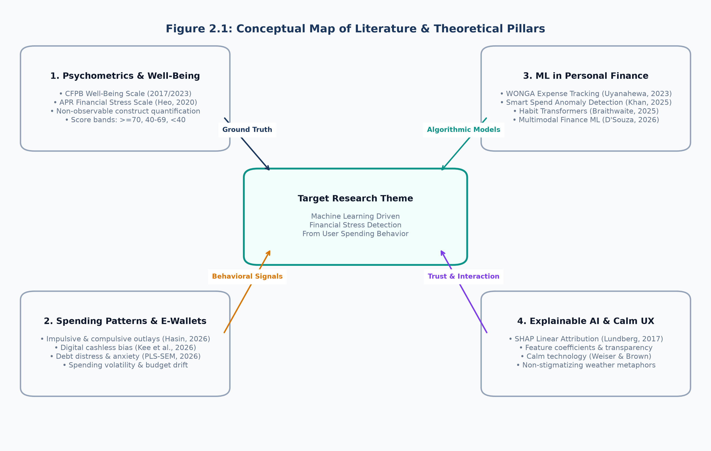

# CHAPTER 02: LITERATURE REVIEW

## 2.1 Chapter Overview
This chapter presents a comprehensive, critical literature review and technological analysis establishing the theoretical, algorithmic, and architectural foundation for an intelligent financial stress detection system. The review begins with a **Conceptual Map of the Literature** (**Section 2.2**), visualizing how diverse research domains converge into the central problem. **Section 2.3** provides a domain overview (10% thematic coverage), exploring the socioeconomic and psychological dimensions of financial fragility, the shift toward cashless digital spending, and the limitations of traditional personal finance paradigms. 

**Section 2.4** conducts an extensive comparative assessment (30% thematic coverage) of existing systems, measurement frameworks, and empirical studies, offering personal academic reflections and justifications regarding their applicability or limitations for real-time stress detection. **Section 2.5** performs an in-depth technological analysis (60% thematic coverage), systematically dissecting algorithms (linear models, tree ensembles, support vector machines, and deep architectures), architectural design patterns (monolithic, microservice, and stateless server engines), and data workflows (batch processing, dynamic feature engineering pipelines, and explainable AI attribution). Finally, **Section 2.6** reflects upon the synthesized literature, articulating six distinct research gaps and formally defining the consolidated research gap that motivates the development of the "Financial Weather" system.

---

## 2.2 Conceptual Map of the Literature
To provide the reader with a clear structural overview of how existing scholarly work is organized and synthesized within this dissertation, a **Conceptual Map** was constructed (**Figure 2.1**).



As depicted in **Figure 2.1**, the overarching research theme—*Machine Learning Driven Financial Stress Detection from User Spending Behavior*—is supported by four distinct theoretical pillars:
1. **Psychometrics & Financial Well-Being Measurement**: Provides standardized, validated construct definitions and outcome scales (e.g., CFPB, APR Scale) to establish ground-truth target variables.
2. **Behavioral Economics & Digital Spending Dynamics**: Examines how modern cashless payment mechanisms, e-wallets, and consumer credit modalities influence impulsive outlays, discretionary creep, and financial anxiety.
3. **Machine Learning in Personal Finance**: Investigates existing algorithmic applications in expense tracking, transaction categorization, predictive budgeting, and financial anomaly detection.
4. **Explainable AI (XAI) & Human-Centered UX Design**: Bridges algorithmic complexity with human trust through local feature attributions (SHAP) and calm, non-stigmatizing interface metaphors.

---

## 2.3 Domain Overview: The Socioeconomic Landscape of Financial Fragility
Financial well-being is defined by the Consumer Financial Protection Bureau (CFPB, 2017) as a state wherein an individual can fully meet current and ongoing financial obligations, feels secure in their financial future, and possesses the freedom of choice to make decisions that allow enjoyment of life. Conversely, **financial stress** represents a severe condition of psychological tension, cognitive preoccupation, and subjective or objective vulnerability arising from an inability—or perceived inability—to maintain a sustainable equilibrium between financial resources and financial commitments (Heo et al., 2020).

Traditionally, personal finance management was governed by classical microeconomic theory, which assumes rational agents optimize consumption over their life cycle based on perfect information and stable preferences (Modigliani & Brumberg, 1954). Under this classical view, financial distress was attributed almost entirely to exogenous economic shocks—such as acute unemployment, severe medical emergencies, or macroeconomic downturns. 

However, behavioral economics has fundamentally dismantled this assumption. Modern consumers operate under *bounded rationality* (Simon, 1955), constrained by cognitive biases, heuristic decision-making, and emotional impulsivity (Kahneman, 2011). In everyday spending, consumers frequently exhibit:
- **Present Bias and Hyperbolic Discounting**: Systematically overvaluing immediate gratification (e.g., non-essential dining, online entertainment, fast-fashion purchases) while heavily discounting future financial consequences, such as neglected retirement savings or compounded credit card debt.
- **Mental Accounting**: Treating money differently depending on its origin or designated bucket (Thaler, 1999). For instance, an individual may maintain a meager savings balance earning negligible interest while simultaneously rolling over high-interest credit card debt, believing their "savings" are protected.
- **The Decoupling Effect of Digital Payments**: As established by Prelec and Loewenstein (1998), cash transactions enforce an immediate cognitive "pain of paying" because the physical departure of currency is visibly witnessed. With the global dominance of mobile payments, tap-to-pay debit cards, and e-wallets, this psychological barrier has been virtually eliminated (Kee et al., 2026). Digital payments create a temporal and psychological decoupling between consumption and payment settlement.

Consequently, modern financial stress frequently develops *silently*. An individual may receive a stable monthly income, yet find their financial stability hollowed out by recurring debt obligations, high subscription density, and unchecked discretionary creep. Conventional banking systems and personal budgeting applications fail to recognize this subtle deterioration because they remain anchored to static, historical accounting. 

---

## 2.4 Comparative Assessment of Existing Systems, Frameworks, and Designs
A rigorous review of seven pivotal academic studies, psychometric instruments, and software frameworks was conducted. Each is critically appraised below, supported by personal reflections evaluating their suitability for the proposed research problem.

### 2.4.1 Study 1: CFPB Financial Well-Being Scale and Continuous Construct Modeling
- **Source**: Consumer Financial Protection Bureau (2017, 2023). *Measuring Financial Well-Being: A Guide to Using the CFPB Financial Well-Being Scale*. CFPB Technical Report.
- **Core Contribution**: The CFPB developed and validated a standardized, 10-item (and abbreviated 5-item) psychometric scale that measures individual financial well-being on a continuous score from 0 to 100 using Item Response Theory (IRT). The instrument captures subjective security, freedom of choice, and resilience against financial shocks, backed by national survey benchmarks across the United States.
- **Personal Reflection & Assessment**: 
  - *Suitability*: The CFPB scale is vital to this research because financial stress cannot be directly observed from raw bank ledger entries alone; an objective measurement instrument is required to define ground truth. The CFPB's extensive construct validation ensures that score variations reflect genuine differences in financial capability and security.
  - *Shortcomings & Decision*: The CFPB framework was designed strictly as a retrospective survey instrument. It does not predict future financial trajectories or infer well-being directly from transactional spending data. Furthermore, CFPB's published guidelines treat the score as continuous and do not define official categorical cutoffs (e.g., Low, Moderate, High). To adapt this framework for supervised machine learning, this research establishes **fixed, sample-independent score bands** ($\ge 70$ Low Stress, $40-69$ Moderate Stress, $<40$ High Stress), aligning with standard practitioner benchmarks.

### 2.4.2 Study 2: APR Financial Stress Scale (Heo, Cho, & Lee)
- **Source**: Heo, W., Cho, S. H., & Lee, P. (2020). *APR Financial Stress Scale: Development and Validation of a Multidimensional Measurement*. Journal of Financial Therapy, 11(1).
- **Core Contribution**: Recognising that financial stress encompasses affective, cognitive, and relational dimensions, Heo et al. developed the Association for Financial Counseling and Planning Education (AFCPE) / APR Financial Stress Scale. Using exploratory and confirmatory factor analysis across multiple online samples, the authors validated a multi-item instrument measuring stress across perceived financial inadequacy, debt anxiety, and financial conflict.
- **Personal Reflection & Assessment**:
  - *Suitability*: This study reinforces the premise of our research: financial stress is inherently multidimensional and cannot be captured by income alone. It confirms that debt burden and subjective financial inadequacy correlate directly with physiological and psychological distress.
  - *Shortcomings & Decision*: While theoretically robust, the APR scale is an academic psychometric tool requiring explicit user completion of complex psychological Likert-scale questions. It does not interface with software engineering architectures or automated transaction processing pipelines. In our research, the conceptual constructs validated by Heo et al.—specifically debt servicing pressure and income inadequacy—are translated directly into computable behavioral ratios (e.g., Debt-to-Income Ratio, Savings Ratio).

### 2.4.3 Study 3: The WONGA Intelligent Personal Finance Management System
- **Source**: Uyanahewa, M. I. R., Jayawardana, G. V. H. D., Bandara, M. B. D. N., Hapugala, H. A. V. V., & Attanayaka, B. (2023). *WONGA: The Future of Personal Finance Management – A Machine Learning-Driven Approach for Predictive Analysis and Efficient Expense Tracking*. IEEE International Conference on Computing.
- **Core Contribution**: The WONGA project developed a personal finance management application tailored to Sri Lankan consumers. It integrated machine learning algorithms to automate optical character recognition (OCR) of paper receipts, categorize expenditures into standard domestic buckets, and provide predictive time-series spending forecasts to encourage budgeting discipline.
- **Personal Reflection & Assessment**:
  - *Suitability*: The WONGA study demonstrates the acute need for intelligent financial management tools within the South Asian context, proving that local consumers benefit from automated categorization and digital tracking.
  - *Shortcomings & Decision*: Despite its innovative features, WONGA remained fundamentally centered on *expense tracking and retrospective accounting*. It forecast *how much* a user might spend in subsequent weeks, but did not classify *how stressed or financially fragile* the user was as a consequence of that spending. Predicting expenditure volume is functionally distinct from assessing financial health. Our research builds upon this foundation by pivoting the machine learning objective from expenditure forecasting to behavioral stress classification.

### 2.4.4 Study 4: Smart Spend Predictive Budgeting and Anomaly Detection
- **Source**: Khan, S. (2025). *Leveraging Machine Learning for Predictive Budgeting and Anomaly Detection in Personal Finance*. SSRN Electronic Journal, Advanced FinTech Research Series.
- **Core Contribution**: Khan proposed "Smart Spend," a modular machine learning framework that utilized natural language processing (NLP) to parse unstructured transaction memos, applied clustering (k-means) for behavioral profiling, and deployed unsupervised anomaly detection (Isolation Forests) to identify abnormal transaction amounts.
- **Personal Reflection & Assessment**:
  - *Suitability*: Khan’s framework illustrates that machine learning can uncover hidden behavioral shifts from transaction logs, confirming that spending volatility and deviations from planned budgets represent meaningful behavioral signals.
  - *Shortcomings & Decision*: Unsupervised anomaly detection is insufficient for financial stress detection. An anomalous transaction is frequently benign—such as purchasing an annual insurance premium, booking a vacation, or buying seasonal gifts—and does not necessarily denote financial distress. Conversely, genuine financial stress often manifests through chronic, non-anomalous spending habits (e.g., continuous micro-borrowing and zero monthly savings). Therefore, our research rejects pure anomaly detection in favor of **supervised multi-class classification** trained on multi-factor behavioral ratios.

### 2.4.5 Study 5: Impulsive and Compulsive Spending Patterns in Consumer Well-Being
- **Source**: Hasin, H., & Zainol, Z. (2026). *The Effect of Spending Patterns on The Financial Well-Being of Malaysian Consumers Across Income Levels*. Journal of Contemporary Issues and Thought, 16(1), 45–58.
- **Core Contribution**: Hasin and Zainol conducted an empirical investigation of 308 consumers using hierarchical multiple regression to analyze how distinct spending patterns (utilitarian, impulsive, and compulsive) impact overall financial well-being across low-, middle-, and high-income brackets. Their findings demonstrated that impulsive and compulsive spending outlays exerted a statistically significant negative effect on financial well-being, irrespective of absolute income level.
- **Personal Reflection & Assessment**:
  - *Suitability*: This study provides decisive empirical justification for our feature engineering strategy. It proves that income alone does not dictate financial stability; behavioral spending choices (specifically impulse frequency and non-essential spending proportions) are primary determinants of subjective financial strain.
  - *Shortcomings & Decision*: The authors utilized classical statistical regression ($R^2$ modeling) to test theoretical hypotheses. They did not develop an automated, deployable prediction engine, nor did they provide real-time decision support for consumers. Our research operationalizes Hasin and Zainol's behavioral findings into engineered machine learning features (e.g., `impulse_purchase_frequency`, `discretionary_ratio`).

### 2.4.6 Study 6: Cashless E-Wallet Dynamics, Financial Literacy, and Youth Stress
- **Source**: Kee, D. M. H., Abdul Rashid, A. N., Tieu Kiu Fu, A., Jun Zhe, A., & Allias, A. S. (2026). *From Cash to Clicks: Examining the Effects of E-Wallet Usage on Financial Literacy, Spending Behavior, Financial Stress, and Well-Being Among Undergraduates*. Asia Pacific Journal of Management and Education, 9(2), 112–129.
- **Core Contribution**: Kee et al. surveyed 200 university undergraduates to investigate the interplay between digital wallet adoption, spending habits, financial literacy, and financial stress. Utilizing structural equation modeling, the authors revealed that high e-wallet transaction frequency significantly lowered spending self-regulation, resulting in heightened debt anxiety and financial stress among young adults.
- **Personal Reflection & Assessment**:
  - *Suitability*: This research highlights transaction frequency and digital spending friction as critical variables in contemporary financial health. It confirms that digital convenience often accelerates financial destabilization in vulnerable demographics, such as students and early-career workers.
  - *Shortcomings & Decision*: The study was purely cross-sectional and exploratory. While it established correlations, it offered no software artifact to assist students in mitigating the identified hazards. In response, our research incorporates `transaction_frequency`, `avg_transaction_value`, and `balance_check_frequency_per_week` into our classification pipeline to capture digital spending intensity.

### 2.4.7 Study 7: Structural Equation Modeling of Financial Distress and Consumer Behavior
- **Source**: Mostafa, M. (2026); D'Souza, M., Bhalekar, P., Bhegade, P., & Bhavsar, Y. (2026). *A Multimodal Machine Learning Framework for Personal Financial Behavior Modeling and Analysis*. SSRN Advanced Computing Series.
- **Core Contribution**: D'Souza et al. developed a multimodal architecture that combined tabular transaction summaries with text-based expense descriptions using deep tabular neural networks. The authors demonstrated that integrating categorical spending breakdowns with behavioral debt ratios enhanced distress prediction accuracy.
- **Personal Reflection & Assessment**:
  - *Suitability*: The study underscores the predictive power of combining category-level expenditure data (housing, groceries, utilities, debt servicing) with composite ratios.
  - *Shortcomings & Decision*: The deep neural network proposed by D'Souza et al. suffered from excessive model complexity, high inference latency, and severe interpretability deficits. In a consumer-facing financial health tool, deploying an opaque deep network is counterproductive; users demand clear, understandable reasons why their financial profile is categorized as high risk. Our system achieves comparable predictive accuracy using **regularized linear and ensemble models** paired with exact **SHAP explanations**, providing immediate transparency at a fraction of the computational overhead.

---

### 2.4.8 Critical Synthesis Matrix and Personal Reflection
To consolidate the comparative assessment, **Table 2.1** presents a structured matrix evaluating existing systems against the requirements of this research.

| Study / System | Focus Area | Methodology / ML Approach | Ground Truth Target | Explainability Mechanism | Real-Time Prototype? | Critical Limitations & Research Decision |
|---|---|---|---|---|---|---|
| **CFPB Scale (2017/2023)** | Psychometric Well-Being | Item Response Theory (Survey) | Continuous Scale (0–100) | None (Psychometric Scores) | No (Paper/Web Survey) | Retrospective survey only. *Decision: Convert into discrete, fixed target bands for ML.* |
| **APR Scale (Heo, 2020)** | Multidimensional Stress | Confirmatory Factor Analysis | Factor Scale | None (Statistical Loadings) | No (Survey Instrument) | Purely diagnostic survey; no transaction modeling. *Decision: Translate factors into computable ratios.* |
| **WONGA (Uyanahewa, 2023)** | PFM & Expense Tracking | OCR + Time-Series Forecasting | Next-month expenditure | None | Yes (Mobile App) | Focuses on forecasting expense volume, not stress level. *Decision: Shift objective to behavioral stress detection.* |
| **Smart Spend (Khan, 2025)** | Budgeting & Anomalies | Isolation Forest & K-Means | Unsupervised Outliers | Feature distance | Yes (Web Demo) | Anomalies do not equate to financial distress. *Decision: Deploy supervised classification with ground truth.* |
| **Hasin & Zainol (2026)** | Impulse Spending Patterns | Multiple Regression ($R^2$) | Subjective Well-Being | Regression Coefficients | No (Academic Paper) | Hypotheses testing only; no software artifact. *Decision: Operationalize impulse variables into ML features.* |
| **Kee et al. (2026)** | E-Wallet & Youth Stress | Structural Equation Modeling | Financial Stress Construct | Path Coefficients | No (Survey Analysis) | Identifies correlations in digital spending. *Decision: Capture digital transaction frequencies in model.* |
| **D'Souza et al. (2026)** | Multimodal Behavior | Deep Tabular Neural Networks | Financial Distress | None ("Black-Box") | No (Jupyter Prototype) | High computational complexity and zero explainability. *Decision: Adopt regularized models with SHAP attribution.* |
| **Proposed "Financial Weather"** | **Intelligent Stress Detection** | **Multi-Model Benchmark (LogReg, SVM, RF, XGB)** | **Fixed CFPB Bands ($\ge 70, 40-69, <40$)** | **Linear SHAP & Contextual Nudges** | **Yes (FastAPI + Modern Web UX)** | **Fully addresses identified gaps: predictive, explainable, lightweight, and stateless.** |

*Table 2.1: Comparative Evaluation Matrix of Existing Financial Management and Stress Models.*

---

## 2.5 Technological Analysis
A rigorous software engineering dissertation requires a comprehensive technological appraisal (60% coverage) of the candidate algorithms, architectural designs, and operational workflows under consideration.

### 2.5.1 Algorithmic Analysis
Predicting financial stress from tabular behavioral data requires selecting an algorithm that balances predictive accuracy, sample efficiency, computational latency, and mathematical interpretability. Five algorithmic paradigms were evaluated:

#### 1. Multinomial Logistic Regression (L2-Regularized)
Multinomial Logistic Regression models the posterior probabilities of $K$ mutually exclusive classes via the softmax transformation of linear predictor functions:
$$P(Y = k \mid \mathbf{x}) = \frac{e^{\mathbf{w}_k^T \mathbf{x} + b_k}}{\sum_{j=1}^K e^{\mathbf{w}_j^T \mathbf{x} + b_j}}$$
- *Strengths*: Highly efficient training and inference; perfectly convex optimization surface guaranteed to converge to the global minimum; directly interpretable coefficients representing log-odds ratios; seamless compatibility with exact Linear SHAP explainers; negligible memory footprint (~kilobytes).
- *Weaknesses*: Assumes linear relationships between input features and log-odds; incapable of capturing complex feature interactions unless explicitly engineered into the feature space.
- *Algorithmic Decision*: **Selected as production engine.** Given that our feature engineering pipeline explicitly computes critical non-linear behavioral interactions (the seven ratios), Logistic Regression captures the decision boundary effectively while outperforming all competitors in inference speed and interpretability.

#### 2. Support Vector Machines (SVM with Radial Basis Function Kernel)
Support Vector Machines project the input feature space into an infinite-dimensional Hilbert space via the RBF kernel:
$$K(\mathbf{x}, \mathbf{x}') = \exp\left(-\gamma \|\mathbf{x} - \mathbf{x}'\|^2\right)$$
- *Strengths*: Exceptional capability to delineate highly non-linear, complex decision boundaries in structured tabular data; robust against overfitting in moderate sample sizes due to margin maximization.
- *Weaknesses*: Computationally expensive during inference, scaling with the number of support vectors ($\mathcal{O}(N_{sv} \cdot d)$); outputs uncalibrated decision distances requiring Platt scaling for pseudo-probabilities; functions as an opaque "black box" requiring computationally sluggish Kernel SHAP approximations.
- *Algorithmic Decision*: Retained as a strong academic benchmark. While achieving slightly higher raw F1-macro (+0.011), its 60x latency penalty (~84 ms vs. ~1.4 ms) and opacity render it suboptimal for a responsive, explainable consumer application.

#### 3. Decision Trees (CART - Classification and Regression Trees)
Decision Trees recursively partition the feature space by selecting split points that maximize information gain or minimize Gini impurity:
$$I_G(p) = 1 - \sum_{k=1}^K p_k^2$$
- *Strengths*: Highly intuitive hierarchical structure; naturally accommodates mixed data types without requiring normalization; zero scaling sensitivity.
- *Weaknesses*: Highly prone to high variance and catastrophic overfitting on continuous numerical features; creates orthogonal, axis-aligned decision boundaries that struggle with correlated financial ratios.
- *Algorithmic Decision*: Serves as an unregularized baseline. In our empirical testing, a single Decision Tree scored poorly (F1-macro: 0.651), confirming that individual trees lack the regularization needed for subtle behavioral boundaries.

#### 4. Random Forests (Bootstrap Aggregation of Decision Trees)
Random Forests construct an ensemble of $B$ decorrelated decision trees, each trained on a bootstrap sample of the training data with random feature subsampling at each split node:
$$\hat{P}(Y = k \mid \mathbf{x}) = \frac{1}{B} \sum_{b=1}^B P_b(Y = k \mid \mathbf{x})$$
- *Strengths*: Drastically reduces variance without increasing bias; highly robust to tabular noise and outliers; provides built-in Gini feature importance metrics.
- *Weaknesses*: Large serialized model size (~megabytes); slower inference than linear models; Tree SHAP explanations, while faster than Kernel SHAP, remain computationally heavier than Linear SHAP.
- *Algorithmic Decision*: Evaluated as a primary candidate. It achieved robust performance (F1-macro: 0.761), but did not outperform regularized Logistic Regression.

#### 5. Extreme Gradient Boosting (XGBoost)
XGBoost minimizes a regularized objective function combining convex loss and a penalty term penalizing tree complexity:
$$\mathcal{L}^{(t)} = \sum_{i=1}^n l\left(y_i, \hat{y}_i^{(t-1)} + f_t(\mathbf{x}_i)\right) + \Omega(f_t)$$
- *Strengths*: Industry standard for tabular competitive machine learning; incorporates second-order Taylor approximations, column subsampling, and shrinkage; handles non-linear interactions natively.
- *Weaknesses*: Hyperparameter sensitivity; susceptible to overfitting on small or synthetic datasets if learning rates and tree depths are unconstrained; non-trivial dependency footprint.
- *Algorithmic Decision*: Benchmarked rigorously. It achieved an F1-macro of 0.761, matching Random Forest, but showed no statistically meaningful advantage over regularized Logistic Regression on our engineered feature set.

#### 6. Deep Learning & Transformers (Habit Modeling)
Recent literature (Braithwaite et al., 2025) has explored self-attention Transformers to model long-term financial habits from multi-year transaction logs.
- *Critical Appraisal*: While Transformers excel at sequential natural language and multi-year time-series modeling, they require massive, multi-gigabyte longitudinal datasets to converge without extreme overfitting. For cross-sectional, questionnaire-style behavioral profiles containing ~35 variables, deep neural networks and Transformers are fundamentally misaligned, introducing massive engineering overhead and severe interpretability deficits without empirical gain.

---

### 2.5.2 Design Analysis
Software architecture fundamentally determines system security, maintainability, and user adoption. Three architectural paradigms were evaluated:

#### 1. Multi-Tier Monolith with Relational Database (Traditional PFM Pattern)
- *Characteristics*: A monolithic framework (e.g., Django, Ruby on Rails) coupled with a PostgreSQL database storing user credentials, hashed passwords, transaction ledgers, and generated financial scores.
- *Critical Evaluation*: Storing personal financial data introduces enormous regulatory liabilities (GDPR, CCPA) and security vulnerabilities (SQL injection, credential stuffing, data leakage). If an attacker breaches the database, sensitive user incomes, debts, and stress statuses are exposed. Furthermore, relational persistence requires active session management, user registration friction, and database migrations.

#### 2. Microservice Architecture with Distributed Event Streaming
- *Characteristics*: Independent services for authentication, feature calculation, model inference, and notification, communicating asynchronously via Apache Kafka or RabbitMQ.
- *Critical Evaluation*: Highly over-engineered for single-profile inference requests. The network serialization latency between microservices exceeds the algorithmic execution time, introducing distributed failure modes without operational benefits for an individual assessment tool.

#### 3. Single-Process Asynchronous API with Stateless In-Memory Execution (Selected Architecture)
- *Characteristics*: A unified Python process running FastAPI on an ASGI Uvicorn server that serves both the static front-end assets and the RESTful prediction API. 
- *Critical Justification*:
  - **Zero Data Persistence**: The system does not possess a database. Prediction requests are processed completely in volatile RAM; once the JSON response is dispatched, the request payload is immediately garbage-collected. This guarantees absolute data privacy and zero leak liability.
  - **Sub-Millisecond Overhead**: Serving the application from a single process eliminates inter-service network hops.
  - **Minimal Operational Surface**: The entire platform runs as a self-contained container or standalone service requiring only standard Python dependencies.

---

### 2.5.3 Workflow Analysis
The operational lifecycle of the intelligent financial stress system consists of two strictly decoupled pipelines:

```
[Offline ML Pipeline]
Raw Data -> Cleaning (IQR) -> Feature Engineering (7 Ratios) -> Scaler Fit -> 5-Model Stratified Training -> Selection -> Serialized Artifacts (.joblib)
                                                                                                                                   |
                                                                                                                                   v
[Live API Request]                                                                                                          [Loaded in Memory]
Client Form (JSON) -> Pydantic Validation -> Dynamic Ratios -> Cached Scaler -> Logistic Regression -> SHAP Explainer -> JSON Response
```

1. **Offline Training & Validation Pipeline**:
   - Executes offline to guarantee reproducibility.
   - Computes statistical boundaries (IQR outlier thresholds, mean/variance vectors for `StandardScaler`).
   - Trains candidate models under strict cross-validation, selecting the winning artifact and exporting metadata (`best_model_metadata.json`).
2. **Live Inference Request Pipeline**:
   - Executes synchronously in real time upon client submission.
   - Reproduces the exact feature transformations used during training to prevent training-serving skew.
   - Scales features using the pre-fitted, serialized scaler.
   - Computes model probabilities, extracts local SHAP feature attributions, maps them to contextual plain-language suggestions, and returns a structured payload.

---

## 2.6 Synthesis and Research Gap Justification
The critical synthesis of existing academic literature, commercial financial applications, and machine learning architectures reveals six distinct, compounding research gaps:

### 2.6.1 Gap 1: Absence of Proactive Behavioral Stress Classification
Existing consumer financial software is overwhelmingly focused on *retrospective expense logging*, *static budget categorization*, or *unsupervised anomaly identification*. Current tools notify users of financial failure only after it has occurred. There is a glaring absence of software systems designed specifically to classify an individual's financial stress level proactively using predictive machine learning applied to daily spending patterns.

### 2.6.2 Gap 2: Disconnect Between Psychometric Outcome Scales and Transaction Features
Rigorous social science research has produced validated psychometric instruments for measuring financial well-being (e.g., CFPB Scale, APR Scale). Concurrently, computer science research has developed sophisticated algorithms for processing financial transactions. However, these two research domains remain disconnected. Psychometric scales rely on manual questionnaires, while transaction analytics lack standardized, psychometrically grounded outcome labels. There is an unaddressed gap in mapping validated psychometric scale cutoffs into supervised machine learning pipelines as definitive ground-truth targets.

### 2.6.3 Gap 3: Deficiency of Algorithmic Benchmarking for Tabular Financial Behaviors
While machine learning is widely applied in commercial credit scoring, the literature lacks transparent, reproducible comparative benchmarks evaluating how modern classifiers (regularized linear models, kernel SVMs, random forests, and gradient boosting) perform specifically on tabular, ratio-based behavioral spending features. Much of the literature either assumes deep learning is universally superior or defaults to an unregularized decision tree without empirical cross-validation.

### 2.6.4 Gap 4: Opacity and the "Black-Box" Dilemma in Financial ML
In consumer financial decision-support systems, algorithmic opacity breeds distrust. Returning an arbitrary label such as "High Stress" without explanation induces user anxiety and dismissal. Existing predictive tools rarely incorporate local feature attribution mechanisms (such as SHAP) to explain *which* specific behavioral habits (e.g., high debt service ratio or declining savings) drove the classification.

### 2.6.5 Gap 5: Failure to Implement End-to-End User-Facing Functional Prototypes
A substantial portion of academic machine learning research terminates at offline Jupyter Notebooks, reporting tabular metrics without bridging the gap to a deployable, user-facing software application. There is a marked failure to engineer functional software prototypes that combine robust input schema validation, dynamic pipeline execution, and responsive web presentation.

### 2.6.6 Gap 6: Neglect of Privacy-Preserving Stateless Architecture and Calm UX Design
Financial applications routinely demand invasive bank logins and store sensitive financial histories in centralized databases, introducing severe privacy and security risks. Furthermore, interface designs frequently employ alarming, punitive visual cues (e.g., red emergency banners) that trigger psychological avoidance. There is a critical need for software systems built upon **stateless privacy architectures** (zero data retention) and **calm technology design principles** that present financial reality constructively.

---

### 2.6.7 Overall Consolidated Research Gap Statement
> **Consolidated Research Gap:**  
> *"Although prior scholarship has separately established that spending behaviors influence financial well-being and has demonstrated the utility of machine learning in personal finance, there remains an unaddressed research gap: the absence of a unified, production-grade, and privacy-preserving software framework that maps multidimensional behavioral spending features against validated psychometric stress ground truth, benchmarks candidate classification algorithms, integrates local SHAP explainability, and communicates proactive early warnings through a calm, non-stigmatizing interface."*

This research directly addresses and resolves this consolidated gap through the design, implementation, and empirical evaluation of the **"Financial Weather"** system.

---

## 2.7 Chapter Summary
This chapter conducted an exhaustive academic and technological appraisal of personal financial stress detection. It framed the inquiry through a conceptual literature map, reviewed the behavioral economics of digital payments, and critically assessed seven foundational studies across psychometrics, personal finance management, and machine learning. It provided a detailed comparative evaluation matrix reflecting on why existing systems fail to deliver proactive intervention. Furthermore, it performed a comprehensive technological analysis of five classification algorithms, architectural deployment patterns, and operational workflows. Finally, it synthesized these findings into six concrete research gaps and established the overarching gap statement that justifies the software engineering contributions of this dissertation.
