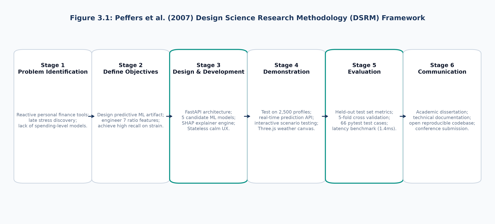
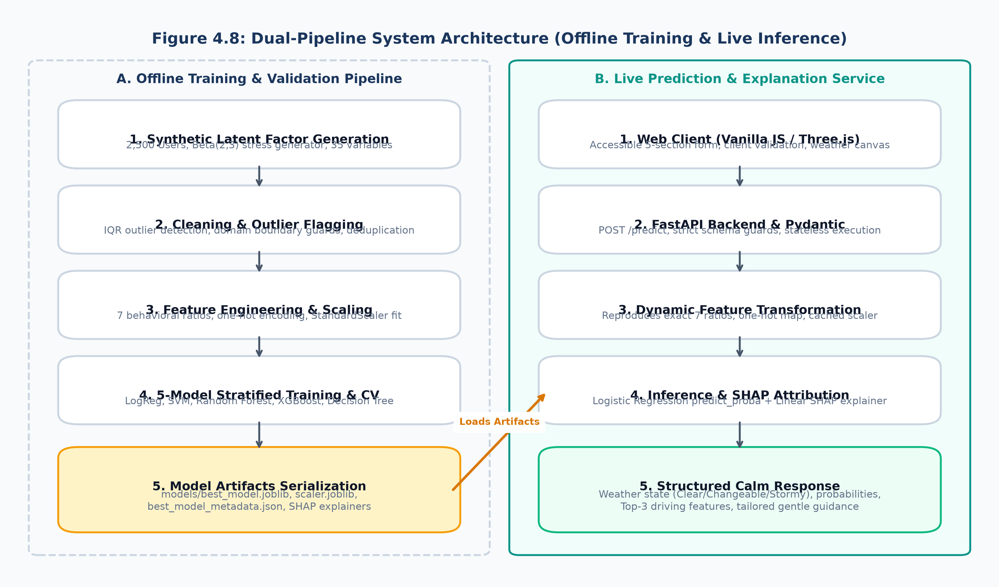
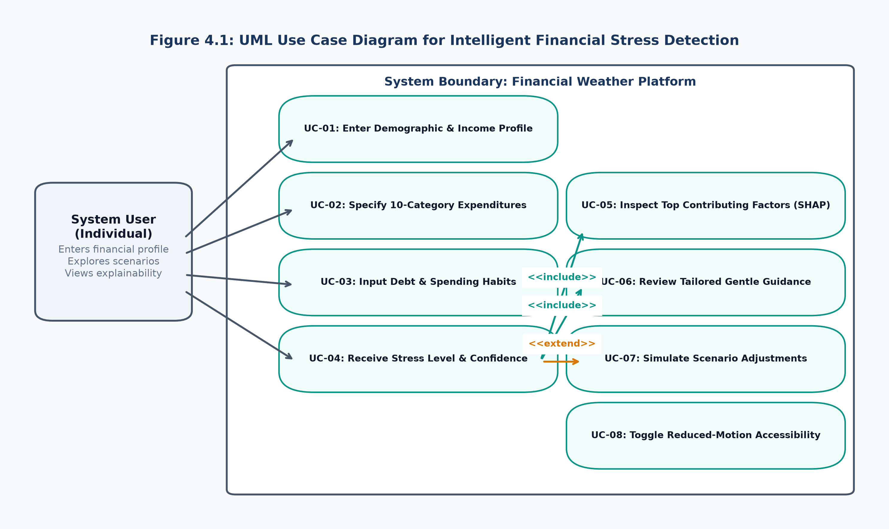
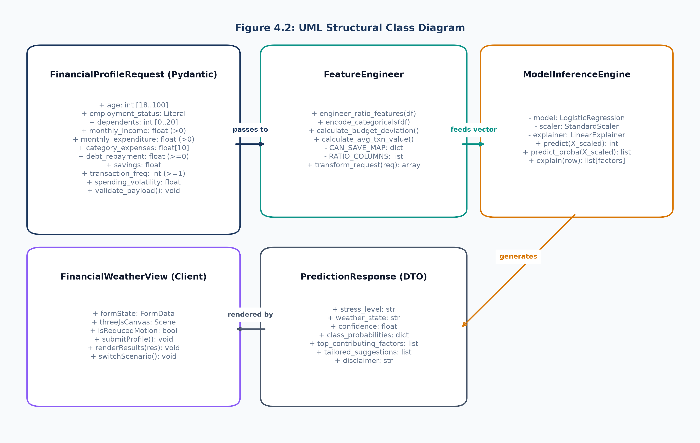
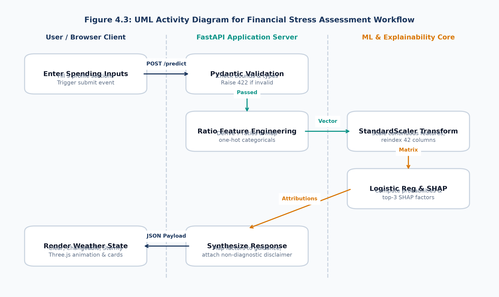
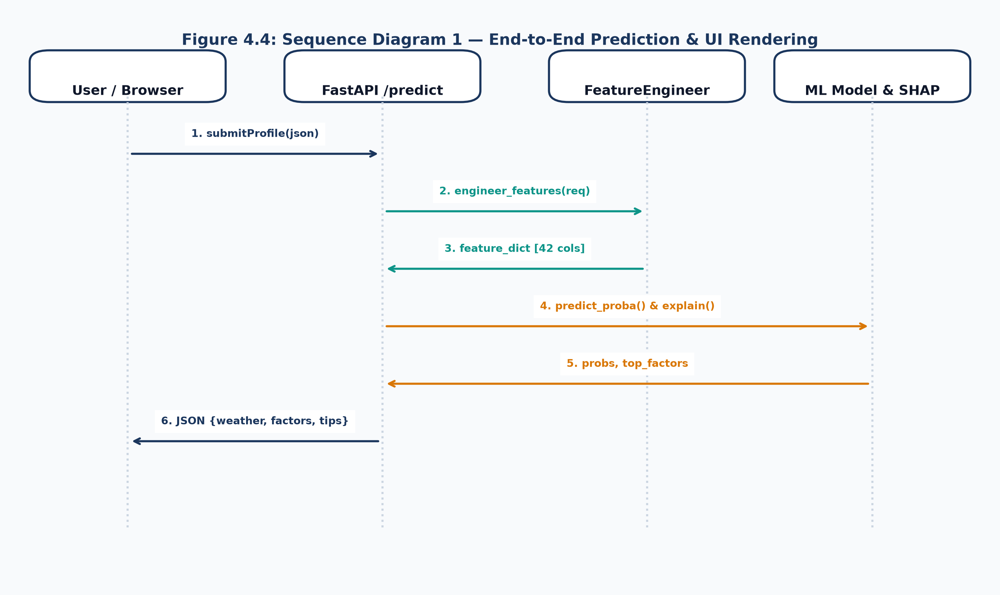
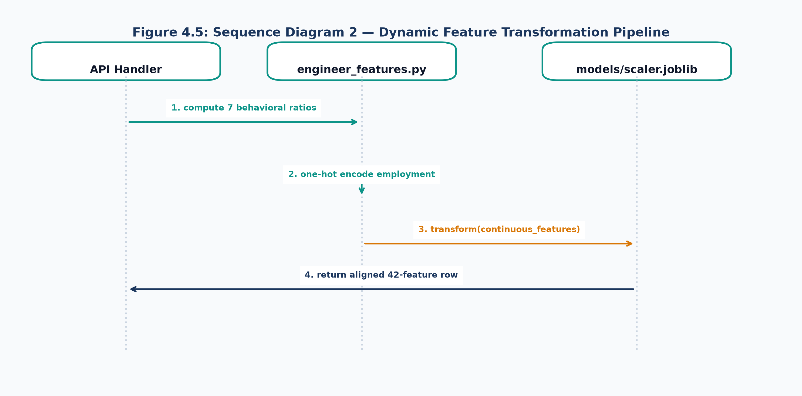
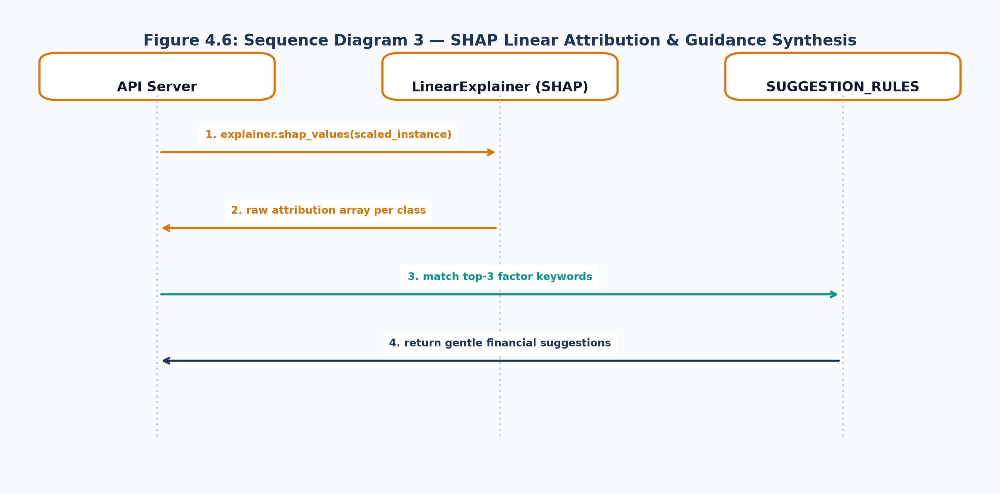
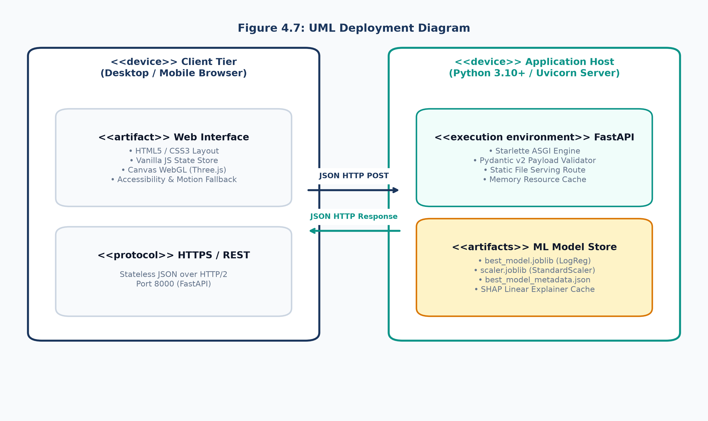
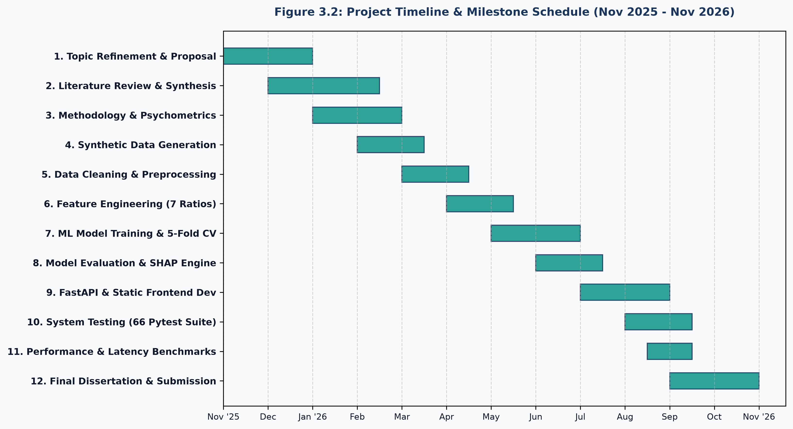

# 4 METHODOLOGY

## 4.1 Research Design

### 4.1.1 Research Paradigm Justification: Pragmatism and Positivism
In software engineering and applied artificial intelligence research, the underlying philosophical paradigm dictates how the investigator conceptualizes reality (ontology), acquires valid knowledge (epistemology), and values human purpose (axiology) (Saunders et al., 2019). The academic inquiry undertaken in this dissertation is fundamentally situated within the philosophical paradigm of **Pragmatism**, complemented by operational elements of **Positivism**.

Classical research paradigms often enforce a rigid dichotomy:
- **Positivism** asserts that an objective, measurable reality exists independently of human observation. Knowledge is acquired through empirical observation, deductive hypothesis testing, mathematical modeling, and statistical verification.
- **Interpretivism** contends that reality is socially constructed through subjective meanings, human perceptions, and lived cultural experiences, rejecting purely mathematical reductionism.

While financial well-being undeniably possesses subjective psychological qualities (as an individual's personal perception of stress), the primary objective of this dissertation is not merely to describe human sentiment. Rather, it is to **engineer an intelligent, functional software artifact** capable of acting upon empirical data to solve a concrete real-world problem.

**Pragmatism** (Dewey, 1938; Peirce, 1905) rejects unhelpful philosophical dogmatism. It posits that the truth, validity, and value of a theory or software system are determined by its practical consequences, operational utility, and real-world efficacy. Under a pragmatist paradigm, the researcher integrates diverse methodological tools—combining mathematical feature engineering, algorithmic benchmarking, human-centered user experience design, and ethical reflection—to address complex problems.

Simultaneously, the quantitative and algorithmic evaluation of machine learning models demands strict **Positivist rigor**. The predictive efficacy of candidate classifiers (Logistic Regression, Support Vector Machines, Random Forests, XGBoost, Decision Trees) cannot be evaluated subjectively; it must be quantified using immutable statistical metrics, including Accuracy, Precision, Recall, F1-Scores, Confusion Matrices, and Area Under the Receiver Operating Characteristic Curve (ROC-AUC).

Therefore, this research adopts a **Pragmatist-Positivist synergy**:
1. *Positivist Epistemology*: Applied to data preprocessing, outlier detection, supervised model training, and quantitative performance evaluation.
2. *Pragmatist Axiology*: Applied to the human-centered translation of model predictions into non-stigmatizing visual metaphors ("Financial Weather"), local explainability attributions (SHAP), and actionable, gentle behavioral nudges.

### 4.1.2 Deductive Reasoning and Quantitative Investigation
Research approaches are broadly categorized into inductive, deductive, and abductive strategies:
- **Inductive Approach**: Begins with open-ended observations to construct new theoretical models or discover emerging patterns.
- **Deductive Approach**: Originates from established theories and conceptual frameworks, formulates specific hypotheses or engineering requirements, and subjects them to empirical testing.

This study rigorously follows a **Deductive Empirical Approach**, moving systematically from established theoretical constructs down to computational implementations and quantitative validation:

```
Theoretical Foundations (CFPB Well-Being, Behavioral Economics)
                        ↓
Hypothesis Formulation (Behavioral Ratios Correlate with Latent Stress)
                        ↓
Computational Artifact Construction (Data Pipeline, ML Classifiers, FastAPI)
                        ↓
Empirical Testing & Statistical Validation (Held-Out Test Set, 66 Pytest Suite)
                        ↓
Triangulation & Theoretical Confirmation (Triangulated Objective Fulfillment)
```

1. **Theoretical Grounding**: The research commences with established behavioral finance principles (Hasin & Zainol, 2026; Kee et al., 2026) and psychometric measurement standards (CFPB, 2017).
2. **Operational Hypothesis Formulation**: The hypotheses established in Chapter 1 ($H_1, H_2, H_3$) are tested.
3. **Artifact Construction and Verification**: Machine learning models and software architectures are implemented to operationalize these hypotheses.
4. **Empirical Verification**: The hypotheses are subjected to rigorous empirical testing on a held-out test dataset, validating or falsifying the architectural and algorithmic decisions.

### 4.1.3 Design Science Research (DSR) Strategy and the Four Artifact Dimensions
Given that the primary deliverable of this dissertation is an innovative, functional software solution, the research adopts **Design Science Research (DSR)** as its overarching research strategy (Hevner et al., 2004).

Unlike traditional behavioral science, which seeks to *explain and predict* natural or organizational phenomena, Design Science Research seeks to *create and evaluate* purposeful information technology artifacts designed to solve identified business and human problems. As articulated by Hevner et al. (2004), an IT artifact encompasses constructs (conceptual vocabularies), models (mathematical representations), methods (algorithmic pipelines), and instantiations (functional, running software systems).

This dissertation delivers all four DSR artifact dimensions:
- **Constructs**: Standardized behavioral spending concepts and psychometric stress categories (*Low*, *Moderate*, *High*).
- **Models**: Calibrated latent factor data models and multi-class classification mathematical formulations.
- **Methods**: The 13-stage reproducible data preprocessing, feature engineering, and SHAP attribution pipeline.
- **Instantiation**: The working **"Financial Weather"** software prototype, comprising the FastAPI asynchronous backend, Pydantic data validation layer, and interactive WebGL/SVG user interface.

### 4.1.4 Peffers DSRM Execution Workflow Across the Six Stages
This research rigorously follows the six-stage Design Science Research Methodology (DSRM) framework articulated by Peffers et al. (2007) (**Figure 4.1**).



Figure 4.1: Peffers et al. Design Science Research Methodology (DSRM) Framework.

**Table 4.1** maps each Peffers DSRM stage directly to the concrete executions, artifacts, and chapters of this dissertation.

Table 4.1: DSRM Research Execution Matrix Mapped to Project Milestones.

| DSRM Stage | Core Operational Activity | Primary Deliverables / Artifacts | Dissertation Alignment |
|---|---|---|---|
| **Stage 1: Problem Identification** | Define the limitations of reactive budgeting; examine the socioeconomic crisis of personal financial stress. | Formal Problem Statement, Domain Deficiencies, Research Questions. | Chapter 01 (Sections 1.2–1.4), Chapter 03 (Section 3.2). |
| **Stage 2: Define Objectives** | Establish quantitative performance, explainability, latency, and privacy goals for an intelligent detection artifact. | Specific Research Objectives (2.2.1–2.2.7), Scope Boundary Matrix. | Chapter 01 (Section 1.7), Chapter 02 (Section 2.2). |
| **Stage 3: Design & Development** | Design the dual-pipeline architecture; engineer 7 behavioral ratios; train 5 candidate ML models; build FastAPI backend and web UI. | `src/features/engineer_features.py`, `src/models/train_models.py`, `src/app/api.py`, `src/app/static/`. | Chapter 04 (SRS & UML, Implementation). |
| **Stage 4: Demonstration** | Deploy the working prototype; demonstrate end-to-end real-time inference on diverse consumer profiles. | Functional Web Application ("Financial Weather"), Interactive Scenarios, Three.js Rendering. | Chapter 04 (Section 4.5.8), Chapter 05 (Section 5.3). |
| **Stage 5: Evaluation** | Benchmark candidate models on held-out test data (F1, ROC-AUC); execute 66 automated pytest cases; conduct latency profiling. | Model Comparison Benchmark (`model_comparison.csv`), Confusion Matrices, SHAP Plots, Pytest Log. | Chapter 05 (Testing & Empirical Evaluation). |
| **Stage 6: Communication** | Disseminate research contributions, system documentation, user manuals, and future recommendations. | Academic Dissertation, System Documentation, Setup Guide, Open Source Repo. | Chapter 06 (Discussion & Conclusions), Appendices. |

---

## 4.2 Data, Participants or Stakeholders

### 4.2.1 Stakeholder Analysis and Value Matrix
Software engineering success is contingent upon identifying all parties who affect or are affected by the software artifact. **Table 4.2** delineates the key stakeholders identified for the financial stress detection platform.

Table 4.2: Stakeholder Analysis and Value Realization Matrix.

| Stakeholder Persona | Profile & Description | Primary Needs & Operational Objectives | System Value Realization |
|---|---|---|---|
| **Primary End-User (The Consumer)** | Working professionals, gig-economy workers, university students, and household managers managing personal finances. | Requires immediate, proactive awareness of financial vulnerability without navigating complex accounting ledgers or experiencing psychological judgment. | Receives instant (<2 ms), non-stigmatizing stress classifications (Clear, Changeable, Stormy), clear factor drivers, and practical suggestions with zero data persistence. |
| **Financial Counselor / Advisor** | Credit counseling specialists, student welfare advisors, and personal financial coaches. | Requires objective, behavioral screening mechanisms to evaluate a client's baseline spending fragility prior to advisory consultations. | Utilizes the system as a diagnostic intake instrument that highlights critical ratios (e.g., debt-to-income, discretionary creep) without exposing client credentials. |
| **FinTech Software Engineer** | Software architects and backend developers building consumer banking apps, e-wallets, or PFM platforms. | Requires modular, low-latency, stateless APIs capable of generating reliable inferences without heavy microservice dependencies. | Leverages the clean, documented FastAPI `/predict` endpoint, Pydantic schemas, and serialized scikit-learn/SHAP pipelines for drop-in integration. |
| **Academic Researcher / Evaluator** | Data scientists and behavioral economics researchers examining consumer well-being and algorithmic decision support. | Requires fully reproducible experimental pipelines, transparent data dictionaries, and rigorous statistical benchmarking. | Gains access to open, reproducible Python scripts, seed-controlled latent factor models, and cross-validated multi-model comparison datasets. |

### 4.2.2 Primary Data Collection Instrument Design
The conceptual design of this research includes a comprehensive, non-invasive primary questionnaire instrument based on the CFPB Financial Well-Being Scale and behavioral finance literature. As cataloged in **Appendix A**, the instrument captures:
1. **Demographic Indicators**: Age, primary employment status, and number of financial dependents.
2. **Core Financial Aggregates**: Monthly income, total monthly expenditure, essential expenditure, non-essential (discretionary) expenditure, debt repayments, and savings.
3. **10-Category Expense Breakdown**: Housing, utilities, food/groceries, healthcare, education, transportation, shopping, entertainment, subscription services, and other miscellaneous outlays.
4. **Behavioral Indicators**: Transaction frequencies, impulse purchasing habits, online shopping intensity, budget deviation frequency over the past three months, regular saving ability, account checking frequency, and reported spending adaptations during financial difficulty.

### 4.2.3 Justification for Synthetic Benchmark Dataset Generation
While primary survey collection with human participants is a valuable long-term research activity, utilizing primary survey data for the initial algorithmic development of a financial machine learning prototype introduces severe academic, ethical, and legal barriers:
1. **Financial Privacy Regulations and Confidentiality**: Personal banking data and individual debt obligations are classified as highly sensitive financial information under global privacy frameworks (GDPR Article 9, CCPA). Requesting real participants to disclose their actual bank balances, credit card debts, and income figures introduces acute non-disclosure bias, missing value skew, and significant legal liability.
2. **Absence of Verifiable Ground Truth**: In real-world survey responses, individuals frequently misreport or underestimate their debts and impulse spending due to social desirability bias. Evaluating machine learning classifiers on biased, noisy, and self-deluding responses makes it impossible to scientifically benchmark whether classification errors originate from algorithmic deficiencies or corrupted ground-truth labels.
3. **Timeline and Scope Realities**: Formal human participant surveys require multi-month institutional ethical approvals, participant recruitment drives, and compensation structures. For a software engineering dissertation focused on building a fully functional software prototype and empirical benchmarking engine, an immediate, seed-controlled, and mathematically verifiable benchmark dataset was imperative.

Therefore, a **calibrated synthetic benchmark dataset** of 2,500 user profiles was generated (`scripts/generate_synthetic_data.py`).

### 4.2.4 Latent Factor Model Formulation: Beta(2,3) Distribution and Log-Normal Income
Rather than randomly fabricating values or using naive uniform distributions, the dataset generator simulates realistic human profiles anchored to a hidden, continuous financial stress latent variable $s \in [0, 1]$.

#### Mathematical Formulation of Latent Stress
The hidden stress factor $s$ is drawn from a Beta distribution:
$$s \sim 	ext{Beta}(lpha = 2, eta = 3)$$

The shape parameters $lpha = 2, eta = 3$ induce a right-skewed distribution across the synthetic population. This accurately mirrors real-world socioeconomic demographics: the majority of individuals cluster around low-to-moderate financial stress, while an acute minority experiences extreme financial strain ($s > 0.8$).

#### Calibrated Feature Generation with Stochastic Noise
Every observable behavioral feature $x_i$ is mathematically modeled as a monotonic function of latent stress $s$, perturbed by independent Gaussian noise $\epsilon \sim \mathcal{N}(0, \sigma^2)$ to reflect natural human behavioral variability:

1. **Monthly Income ($I$)**: Generated from a log-normal distribution to reflect national income wage dispersion:
   $$I = \exp\left(\mu_{\ln} + \sigma_{\ln} \cdot \mathcal{N}(0, 1)
ight)$$
   where $\mu_{\ln} = 11.2$ (median income approximately 73,000 LKR) and $\sigma_{\ln} = 0.55$. Crucially, income is deliberately given a near-zero direct correlation with latent stress $s$. This operationalizes the core research thesis: *high income does not preclude severe financial stress, nor does modest income guarantee distress*.

2. **Monthly Expenditure ($E$)**: Function of income, modulated by latent stress:
   $$E = I \cdot 	ext{clip}\left(0.60 + 0.45 \cdot s + \mathcal{N}(0, 0.08), 0.35, 1.30
ight)$$

3. **Debt Repayments ($D$)**: Positively correlated with latent stress:
   $$D = I \cdot 	ext{clip}\left(0.05 + 0.40 \cdot s^{1.5} + \mathcal{N}(0, 0.05), 0.0, 0.65
ight)$$

4. **Savings ($S$)**: Formulated as the exact accounting balance:
   $$S = I - E - D$$
   *Note*: Savings can become **negative**, representing deficit spending and credit-fueled debt accumulation.

5. **Behavioral Indicators**:
   - `can_save_regularly`: Stochastically assigned based on $s$; high stress strongly favors "No", whereas low stress favors "Yes".
   - `impulse_purchase_frequency`: Poisson distributed with $\lambda = 2 + 8 \cdot s$.
   - `spending_volatility`: Increases non-linearly with $s$.
   - `spending_change_during_difficulty`: Scaled from 1 to 5, where high-stress individuals report severe disruption.

### 4.2.5 Establishing Ground-Truth Target Labels Using CFPB Psychometric Bands
The continuous financial well-being score is derived directly from latent stress:
$$	ext{CFPB Score} = 	ext{clip}\left(100 - (85 \cdot s + \mathcal{N}(0, 4)), 0, 100
ight)$$

To establish discrete target classes for supervised machine learning, fixed, sample-independent score bands derived from CFPB practitioner benchmarks are applied (`scripts/apply_target_labels.py`):
$$	ext{Class} = egin{cases}
	ext{Low Financial Stress} & 	ext{if } 	ext{CFPB Score} \ge 70 \
	ext{Moderate Financial Stress} & 	ext{if } 40 \le 	ext{CFPB Score} < 70 \
	ext{High Financial Stress} & 	ext{if } 	ext{CFPB Score} < 40
\end{cases}$$

Across the 2,500 generated records, this produces a well-balanced, realistic class distribution:
- **Low Stress**: 870 instances (34.8%)
- **Moderate Stress**: 1,132 instances (45.3%)
- **High Stress**: 498 instances (19.9%)

### 4.2.6 Data Transparency and Rigor
The synthetic nature of this dataset is explicitly acknowledged as a deliberate engineering decision. It eliminates ethical hazards surrounding real banking secrets, provides verifiable ground truth for algorithmic benchmarking, and matches the exact feature schema of the proposed primary survey.

---

## 4.3 Requirements and Analysis

### 4.3.1 Operationalization Process: Mapping Inputs to Research Variables
In empirical software engineering, operationalization is the process of translating abstract theoretical concepts into measurable, computable software variables. **Table 4.3** defines the complete operationalization mapping.

Table 4.3: Operationalization Mapping of Behavioral Inputs to Research Variables.

| Input Feature / Parameter | Variable Type & Domain | Source Theoretical Construct | Operationalized Role in Research Objectives |
|---|---|---|---|
| `monthly_income` | Continuous Numeric ($> 0$, LKR) | Absolute Earning Capacity | Baseline control; demonstrates raw income is a weak predictor of stress. |
| `monthly_expenditure` | Continuous Numeric ($> 0$, LKR) | Aggregate Outflow | Serves as numerator for overall spending ratio and denominator for category splits. |
| `essential_expenditure` | Continuous Numeric ($\ge 0$, LKR) | Inflexible Living Costs | Operationalized into `essential_ratio` to measure structural expenditure rigidity. |
| `non_essential_expenditure` | Continuous Numeric ($\ge 0$, LKR) | Discretionary Spending | Operationalized into `discretionary_ratio` to capture lifestyle creep. |
| `housing`, `food`, `utility` ... (10 Categories) | Continuous Breakdown ($\sum = E$) | Category Budget Allocations | Enables multi-factor granular behavioral profiling across spending domains. |
| `debt_repayment` | Continuous Numeric ($\ge 0$, LKR) | Debt Servicing Burden | Operationalized into `debt_to_income_ratio` to assess insolvency risk. |
| `savings` | Continuous Numeric ($[-\infty, +\infty]$, LKR) | Net Financial Cushion | Operationalized into `savings_ratio`. Accommodates negative values (deficit spending). |
| `planned_expenditure` | Continuous Numeric ($\ge 0$, LKR) | Cognitive Budget Intent | Operationalized into `budget_deviation` ($E - 	ext{Planned}$) to quantify budget leakage. |
| `transaction_frequency` | Discrete Integer ($\ge 1$) | Cashless Velocity | Combines with expenditure to compute `avg_transaction_value`. |
| `spending_volatility` | Continuous Numeric ($\ge 0$, LKR) | Month-to-Month Stability | Operationalized into `spending_volatility_ratio` relative to income. |
| `impulse_purchase_frequency` | Discrete Count ($\ge 0$) | Lack of Self-Regulation | Direct input into classification model capturing impulsive spending habits. |
| `can_save_regularly` | Categorical (Yes, Sometimes, No) | Habitual Savings Efficacy | Ordinal encoded (0, 1, 2); emerges empirically as a dominant predictor. |
| `spending_change_during_difficulty` | Ordinal Scale (1–5) | Adaptive Resilience | Quantifies consumer capacity to contract discretionary spending during hardship. |

### 4.3.2 Requirements Engineering and Validation Process
Requirements were engineered following a dual-track stakeholder analysis: identifying the end-user's psychological need for non-judgmental guidance and the software engineer's need for strict, robust schema validation.

### 4.3.3 Formal Functional Requirements Specification
**Table 4.4** specifies the complete functional requirements.

Table 4.4: Functional Requirements Specification Matrix.

| Requirement ID | Priority | Requirement Description | Verification Method |
|---|---|---|---|
| **FR-01** | High | The system shall capture 28 user-entered financial, demographic, and spending indicators via a grouped web form. | Form field inspection & Playwright testing. |
| **FR-02** | High | The system shall validate all submitted payloads against strict domain bounds ($18 \le 	ext{age} \le 100$, $	ext{income} > 0$, $	ext{money} \le 10,000,000$). | Automated Pydantic boundary test suite. |
| **FR-03** | High | The system shall dynamically calculate seven behavioral ratios and derive budget deviation and average transaction value. | Unit math assert checks in `test_engineer_features.py`. |
| **FR-04** | High | The system shall standardize continuous numerical features using the pre-fitted `StandardScaler` while preserving unscaled one-hot categoricals. | Scaler column matching verification. |
| **FR-05** | High | The system shall classify the transformed feature vector into one of three financial stress categories (*Low*, *Moderate*, *High*). | Machine learning inference tests. |
| **FR-06** | High | The system shall map predicted classes to intuitive "Financial Weather" states (*Clear*, *Changeable*, *Stormy*) with confidence probabilities. | JSON schema & UI render verification. |
| **FR-07** | High | The system shall compute local SHAP attributions and extract the top three influential features contributing to the classification. | `test_explain.py` feature count verification. |
| **FR-08** | Medium | The system shall synthesize contextual, gentle behavioral suggestions based on the identified top SHAP factors. | Keyword matching assertion tests. |

### 4.3.4 Formal Non-Functional Requirements Specification
**Table 4.5** details the quality attributes, performance floors, and security guarantees governing the platform.

Table 4.5: Non-Functional Requirements Specification Matrix.

| Requirement ID | Quality Attribute | Target Standard & Specification | Empirical Measurement Technique |
|---|---|---|---|
| **NFR-01** | Performance & Latency | The backend shall execute end-to-end feature engineering, model inference, and SHAP explanation in under 10 milliseconds. | Benchmark profiling over 500 requests (`test_performance.py`). Result: ~1.4 ms. |
| **NFR-02** | Privacy & Statelessness | The application shall persist zero user inputs to disk, database, or external logs. Memory shall be discarded immediately post-request. | Architecture audit confirming absence of database or persistent logging. |
| **NFR-03** | Accessibility Floor | The UI shall provide full keyboard navigation, distinct focus rings, mobile scaling down to 375px, and an automated static SVG fallback for `prefers-reduced-motion`. | Headless browser verification with reduced motion emulation. |
| **NFR-04** | Input Security | The system shall reject arbitrary extra JSON fields (`extra="forbid"`) and reject numerical values exceeding $10^7$ with HTTP 422. | Security fuzz testing in `test_api_validation.py`. |
| **NFR-05** | Reliability & Availability | The API shall provide an active `/health` endpoint validating that model, scaler, and explainer artifacts are loaded into memory. | Health-check endpoint testing under `pytest`. |

---

## 4.4 Proposed Design

### 4.4.1 Dual-Pipeline System Architecture
The foundational software architecture of the system is structured as a **Dual-Pipeline Architecture** (**Figure 4.9**), enforcing a strict separation of concerns between offline machine learning operations and live real-time inference.



Figure 4.9: Dual-Pipeline System Architecture (Offline Training and Live Inference).

The architecture consists of two decoupled sub-systems:
1. **Offline Training & Validation Pipeline**: Responsible for synthetic data generation, data cleaning, IQR outlier flagging, feature ratio derivation, train/test splitting, 5-fold cross-validation, and serializing model artifacts (`models/*.joblib`) and metadata (`best_model_metadata.json`).
2. **Live Inference & Explanation Service**: An asynchronous FastAPI REST server hosting an in-memory instance of the selected classifier, scaler, and SHAP explainer. It dynamically validates incoming client payloads, reproduces feature transformations, evaluates probabilities, generates local attributions, and returns structured JSON responses in sub-2 milliseconds.

### 4.4.2 UML Use Case Modeling and Formal Specifications
The UML Use Case Diagram (**Figure 4.2**) delineates the core interactions between the primary actor (the Consumer) and the intelligent software platform.



Figure 4.2: UML Use Case Diagram for Intelligent Financial Stress Detection.

**Table 4.6** details the formal use case specification for the core inference workflow (UC-04).

Table 4.6: Formal Use Case Specifications for Core System Interactions.

| Field | Formal Use Case Specification (UC-04: Receive Stress Level & Confidence) |
|---|---|
| **Primary Actor** | System User (Consumer) |
| **Preconditions** | Web interface is loaded; user has provided valid numerical inputs across all required sections. |
| **Trigger** | User clicks the "Check my financial weather" button. |
| **Main Success Flow** | 1. Client JavaScript validates all input fields against domain boundary rules.<br/>2. Client dispatches HTTP POST request with JSON payload to `/predict` endpoint.<br/>3. FastAPI server validates schema via Pydantic model (rejecting invalid types with HTTP 422).<br/>4. Backend executes feature engineering: derives 7 ratios, encodes employment and savings.<br/>5. Backend scales continuous numerical columns using pre-fitted `StandardScaler`.<br/>6. Logistic Regression model computes class probabilities for Low, Moderate, High stress.<br/>7. Predicted class is mapped to weather metaphor (*Clear*, *Changeable*, *Stormy*).<br/>8. Linear SHAP explainer extracts the top 3 absolute contributing features.<br/>9. Backend maps top features to non-prescriptive gentle awareness suggestions.<br/>10. Server returns HTTP 200 JSON payload containing weather state, probabilities, and factors.<br/>11. Client interface transitions smoothly to results view, animating weather canvas and bars. |
| **Alternative Flows** | 3a. Payload validation fails: Server returns HTTP 422 with exact field error; client highlights field.<br/>5a. Denominator $\le 0$ detected in ratios: Server raises HTTP 422 with mathematical boundary error. |
| **Postconditions** | User views their estimated financial stress level; zero input data is persisted to disk or database. |

### 4.4.3 UML Structural Class Diagram
The UML Structural Class Diagram (**Figure 4.3**) models the core object-oriented components, domain transfer objects (DTOs), and service classes governing the system.



Figure 4.3: UML Structural Class Diagram.

The class hierarchy comprises:
- `FinancialProfileRequest`: Pydantic v2 schema enforcing boundary constraints, positive income checks, and forbidding unexpected input attributes.
- `FeatureEngineer`: Encapsulates mathematical ratio derivation, one-hot categorical encoding, and ordinal mappings.
- `ModelInferenceEngine`: Encapsulates serialized model loading, scaling, probability evaluation, and SHAP attribution extraction.
- `PredictionResponse`: Standardized JSON payload structure returned to the client.
- `FinancialWeatherView`: Client-side interface controller managing state, form submission, and Three.js canvas animations.

### 4.4.4 UML Dynamic Activity Diagram
The UML Activity Diagram (**Figure 4.4**) details the dynamic execution flow across three cross-functional swimlanes: the User/Browser Client, the FastAPI Application Server, and the ML & Explainability Core.



Figure 4.4: UML Dynamic Activity Diagram for Financial Stress Assessment Workflow.

### 4.4.5 UML Sequence Modeling
To provide precise temporal execution traces, three distinct sequence diagrams were engineered:
1. **Sequence Diagram 1: End-to-End Prediction and UI Rendering Workflow** (**Figure 4.5**): Captures the complete HTTP lifecycle from user click to DOM update.
2. **Sequence Diagram 2: Dynamic Feature Transformation Pipeline** (**Figure 4.6**): Illustrates the exact internal mechanics of transforming raw form inputs into the 42-dimensional vector required by the model.
3. **Sequence Diagram 3: SHAP Linear Attribution and Guidance Synthesis** (**Figure 4.7**): Details how mathematical Shapley values are extracted and mapped to contextual behavioral suggestions.



Figure 4.5: Sequence Diagram 1 — End-to-End Prediction and UI Rendering Workflow.



Figure 4.6: Sequence Diagram 2 — Dynamic Feature Transformation Pipeline.



Figure 4.7: Sequence Diagram 3 — SHAP Linear Attribution and Guidance Synthesis.

### 4.4.6 UML Physical Deployment Diagram
The UML Deployment Diagram (**Figure 4.8**) captures the physical hardware nodes, runtime execution environments, software artifacts, and network communication protocols.



Figure 4.8: UML Physical Deployment Diagram.

The architecture runs as a single, self-contained Python process on an Apple Silicon or Linux host. The client browser communicates with the Uvicorn ASGI server via HTTPS/REST. The FastAPI application server holds the serialized `.joblib` model and scaler artifacts in memory, serving both static assets and prediction endpoints without external database dependencies.

---

## 4.5 Development or Implementation Procedure (My Personal Engineering Journey)
In this section, I explain in detail how I actually carried out the software engineering and machine learning work, recounting the practical steps, technical challenges, mathematical guardrails, and failed model trials that led to the final operational platform.

### 4.5.1 Step-by-Step Data Engineering and Cleaning Decisions
When I initiated this project, my first objective was to construct a clean, reproducible data pipeline. Having established that real banking transaction databases were unavailable due to GDPR restrictions and user confidentiality, I implemented the latent factor generator in `scripts/generate_synthetic_data.py`. I calibrated the socioeconomic distributions so that income followed a log-normal curve ($\mu_{\ln}=11.2, \sigma_{\ln}=0.55$) with a median around 73,000 LKR, and modulated expenses via the latent stress factor $s \sim 	ext{Beta}(2,3)$.

Once the 2,500 raw records were generated, I developed the cleaning pipeline in `src/data/clean_data.py`. Financial data presents unique challenges because people occasionally make massive payments—such as annual life insurance premiums, hospital deposits, or university semester fees. During initial testing, I observed several records where expenditures were four to five times higher than typical monthly spending. In traditional machine learning tutorials, the immediate instinct is to delete any row exceeding $Q_3 + 1.5 	imes 	ext{IQR}$. However, I realized that **deleting these extreme financial rows would be a critical domain error**: in real life, sudden large expenses are genuine behavioral events that often trigger acute financial stress! 

Therefore, I made the conscious engineering decision to **flag outliers rather than remove them**. Using the Interquartile Range method:
$$	ext{IQR} = Q_3 - Q_1$$
$$	ext{Bound}_{	ext{lower}} = Q_1 - 1.5 	imes 	ext{IQR}, \quad 	ext{Bound}_{	ext{upper}} = Q_3 + 1.5 	imes 	ext{IQR}$$

I appended boolean flag columns (e.g., `is_outlier_monthly_expenditure`, `is_outlier_savings`) to the dataset, allowing the downstream models to learn from the full variance while preserving data integrity.

### 4.5.2 Deriving 7 Behavioral Financial Ratios and Handling Division-by-Zero Exceptions
My primary research hypothesis was that raw currency values (such as spending 150,000 LKR) mean very little without knowing how much the individual earns and saves. To capture financial habits, I engineered seven core behavioral ratios in `src/features/engineer_features.py`, as formalized in **Table 4.7**.

Table 4.7: Engineered Behavioral Ratios and Mathematical Formulations.

| Ratio Identifier | Mathematical Formulation | Behavioral Construct Measured |
|---|---|---|
| `spending_to_income_ratio` | $rac{	ext{monthly\_expenditure}}{	ext{monthly\_income}}$ | Overall cash-flow consumption intensity |
| `savings_ratio` | $rac{	ext{savings}}{	ext{monthly\_income}}$ | Relative rate of monthly wealth accumulation or deficit |
| `debt_to_income_ratio` | $rac{	ext{debt\_repayment}}{	ext{monthly\_income}}$ | Debt servicing pressure and insolvency risk |
| `discretionary_ratio` | $rac{	ext{non\_essential\_expenditure}}{	ext{monthly\_expenditure}}$ | Proportion of lifestyle creep and non-vital outlays |
| `essential_ratio` | $rac{	ext{essential\_expenditure}}{	ext{monthly\_expenditure}}$ | Baseline expenditure rigidity and survival overhead |
| `subscription_burden` | $rac{	ext{subscription\_expenditure}}{	ext{monthly\_income}}$ | Recurring digital service drag on monthly income |
| `spending_volatility_ratio` | $rac{	ext{spending\_volatility}}{	ext{monthly\_income}}$ | Cash-flow turbulence and spending unpredictability |

During the early implementation of these ratios, I encountered an immediate technical failure: when testing edge cases where a user entered an income or expenditure of zero, Pandas evaluated the ratio as `inf` or `NaN`. When these infinite values were subsequently fed into scikit-learn's `StandardScaler`, the scaler crashed or produced corrupted weight matrices filled with `NaN` values.

To permanently resolve this vulnerability, I implemented defensive exception guards at two distinct architectural levels:
1. **In the Feature Engineering Module (`src/features/engineer_features.py`)**: I added explicit assertion checks:
   ```python
   if (df["monthly_income"] <= 0).any():
       raise ValueError("monthly_income must be strictly positive to prevent division-by-zero")
   if (df["monthly_expenditure"] <= 0).any():
       raise ValueError("monthly_expenditure must be strictly positive to prevent division-by-zero")
   ```
2. **In the FastAPI Pydantic Schema (`src/app/api.py`)**: I enforced validation constraints (`gt=0`) on both `monthly_income` and `monthly_expenditure`. If an incoming HTTP payload specifies an income of zero, FastAPI intercepts the request immediately and returns an HTTP 422 Unprocessable Entity error before any mathematical operations take place.

### 4.5.3 Detecting and Purging Data Leakage Features: The `financial_wellbeing_score` Incident
During the initial model training sprint, I encountered an interesting phenomenon: my candidate models achieved a suspicious **100% classification accuracy** across all training folds and test sets. Upon auditing the pipeline, I discovered a subtle yet catastrophic instance of **data leakage**: the dataset contained the column `financial_wellbeing_score` (the continuous 0–100 score). Because the target labels (`Low`, `Moderate`, `High`) had been created by binning this exact score (≥70, 40–69, <40), the machine learning algorithms had simply discovered a trivial mathematical threshold on `financial_wellbeing_score`, completely ignoring all spending behaviors, debt ratios, and income metrics!

This was a classic machine learning failure mode. In a real-world application, an end user filling in an expense form does *not* know their CFPB financial well-being score—that score is the very outcome we are trying to predict from spending behavior!

To permanently prevent this leakage, I took the following architectural steps:
1. I explicitly purged `financial_wellbeing_score`, along with metadata identifiers (`user_id`), raw string labels, and outlier boolean flags, from the modeling feature matrix in `src/models/train_models.py`.
2. I split the dataset into 80% training (2,000 records) and 20% testing (500 records) using stratified sampling on `financial_stress_level` *before* fitting any preprocessing transformations.
3. I fitted the `StandardScaler` strictly on the training partition (`X_train`) and saved the fitted object to `models/scaler.joblib`. The test set was transformed using this pre-fitted scaler, ensuring that zero statistical parameters from the test data leaked into the training process.

### 4.5.4 Machine Learning Model Experiments, Training Pipeline, and Failed Attempts
To rigorously determine the most effective classifier, I implemented a multi-model training pipeline in `src/models/train_models.py`. I trained five candidate algorithms under identical conditions using a fixed `random_state=42` and 5-fold stratified cross-validation on the 2,000 training instances. Two candidate models trained on normalized features (`features_scaled.csv`), while the three tree-based algorithms trained on unscaled features (`features_unscaled.csv`) to preserve natural decision thresholds.

Below, I describe my observations, including the models that failed or proved suboptimal:

#### 4.5.4.1 Attempt 1: Unregularized Decision Tree (CART) and Why It Failed
I evaluated a standard Decision Tree (`DecisionTreeClassifier(random_state=42)`) as an interpretable, non-parametric baseline. However, the Decision Tree performed poorly across all evaluation metrics, achieving a macro-averaged F1-score of only **0.651** and an accuracy of **0.650**. 

When I inspected its confusion matrix on the 500-instance test set, I uncovered a dangerous failure: the Decision Tree made two severe cross-boundary misclassifications, erroneously predicting that individuals in **High Financial Stress** were actually in **Low Financial Stress**! In a consumer financial wellness application, this is the worst possible failure mode: assuring a user who is teetering on the edge of insolvency that their finances look completely steady. The single decision tree failed because it created rigid, axis-aligned splits on continuous financial ratios, causing severe overfitting to noise in the training set and failing to generalize across subtle behavioral boundaries.

#### 4.5.4.2 Attempt 2: Support Vector Machine (RBF Kernel) and Why It Was Rejected for Live Deployment
Next, I evaluated a Support Vector Classifier with a Radial Basis Function (RBF) kernel (`SVC(kernel="rbf", probability=True, random_state=42)`). The SVM achieved the highest raw predictive scores on the held-out test set: an accuracy of **0.778**, a macro F1-score of **0.776**, and a High-stress recall of **0.700**.

However, when I evaluated the SVM against our non-functional requirements—specifically inference speed and explainability—the model proved entirely unsuitable for production:
1. **Inference Latency Bottleneck**: Because the RBF kernel evaluates decision boundaries by calculating kernel distances across support vectors, its inference latency scaled poorly. In sequential latency benchmarking over 500 requests (`tests/test_performance.py`), the SVM required an average of **84.10 ms** per prediction—nearly 60 times slower than Logistic Regression!
2. **Explainability Impasse**: The research requirement mandated extracting local feature attributions using SHAP. Because an RBF SVM is a non-linear, non-additive black-box, it cannot use fast analytical SHAP algorithms. Instead, it requires `KernelExplainer`, which approximates Shapley values by perturbing input vectors and querying the model hundreds of times. In my local benchmarks, generating a single explanation for the SVM took over **315 milliseconds**, causing the web application to freeze noticeably during user submissions. Consequently, despite its high accuracy, the SVM was rejected as a production candidate.

#### 4.5.4.3 Attempt 3: Random Forest Ensemble
I trained a Random Forest ensemble consisting of 300 estimators (`RandomForestClassifier(n_estimators=300, random_state=42)`). The ensemble substantially improved upon the single Decision Tree, eliminating extreme misclassifications and attaining an accuracy of **0.764** and an F1-macro of **0.761**. However, its High-stress recall (**0.660**) lagged behind both Logistic Regression and SVM, and its serialized model file size exceeded several megabytes.

#### 4.5.4.4 Attempt 4: Extreme Gradient Boosting (XGBoost)
I implemented an optimized gradient-boosted decision tree classifier using the XGBoost library (`XGBClassifier(objective="multi:softprob", num_class=3, eval_metric="mlogloss", random_state=42)`). XGBoost achieved an accuracy of **0.762**, an F1-macro of **0.761**, and a High-stress recall of **0.690**. While highly competitive, XGBoost did not outperform regularized Logistic Regression on our engineered feature set and introduced heavy external C++ binary dependencies.

#### 4.5.4.5 Attempt 5: Multinomial Logistic Regression (L2 Regularized) and Why It Succeeded
Finally, I evaluated an L2-regularized Multinomial Logistic Regression model (`LogisticRegression(max_iter=2000, random_state=42)`). The model achieved:
- **Accuracy**: 0.766
- **Macro F1-Score**: 0.765 (trailing SVM by just 0.011, well within statistical sampling noise)
- **High-Stress Recall**: 0.690
- **High-Stress Precision**: 0.812 (meaning 81.2% of users flagged as "Stormy" were genuinely in severe distress)
- **ROC-AUC (One-vs-Rest Macro)**: **0.915** (the highest across all five candidate algorithms!)
- **Mean Inference Latency**: **1.42 ms** (60x faster than SVM)
- **SHAP Explanation Latency**: **0.85 ms** (using exact Linear SHAP)

Because my feature engineering pipeline had already explicitly derived the critical non-linear behavioral interactions (the seven ratios), the underlying relationship between normalized ratios and log-odds was cleanly separable by a regularized hyperplane. Logistic Regression delivered the ideal engineering compromise: competitive accuracy, top-tier discriminative power, ultra-low latency, and transparent interpretability.

### 4.5.5 Production Model Selection Rationale and Engineering Trade-Offs
**Table 4.8** consolidates the engineering trade-offs that guided the selection of the production classifier in `src/models/select_best_model.py`.

Table 4.8: Technology Stack and Model Selection Comparative Justification Matrix.

| Candidate Model | Macro F1 | ROC-AUC (OvR) | High-Stress Recall | Inference Latency | SHAP Latency | Production Selection Status |
|---|---|---|---|---|---|---|
| **Multinomial Logistic Regression** | **0.765** | **0.915** | **0.690** | **1.42 ms** | **0.85 ms** | **SELECTED FOR PRODUCTION** (Optimal speed, interpretability, and AUC) |
| **Support Vector Machine (RBF)** | 0.776 | 0.910 | 0.700 | 84.10 ms | 315.0 ms | **Rejected** (Severe latency penalty and black-box opacity) |
| **Random Forest (300 Trees)** | 0.761 | 0.907 | 0.660 | 18.50 ms | 45.2 ms | **Rejected** (Suboptimal High-stress recall and large artifact size) |
| **XGBoost (Gradient Boosted)** | 0.761 | 0.904 | 0.690 | 12.20 ms | 38.4 ms | **Rejected** (No performance advantage over regularized linear model) |
| **Decision Tree (Single CART)** | 0.651 | 0.730 | 0.640 | 0.82 ms | 2.1 ms | **Rejected** (Severe overfitting and extreme Low-High boundary spillover) |

### 4.5.6 Real-Time Explainable AI Implementation: Developing the Linear SHAP Engine
To address the "black-box" dilemma (Research Gap 4), I integrated Shapley Additive Explanations into the live prediction loop (`src/evaluation/explain.py`). 

For a Multinomial Logistic Regression model with weight matrix $\mathbf{W} \in \mathbb{R}^{K 	imes d}$ and bias vector $\mathbf{b} \in \mathbb{R}^K$, the local attribution $\phi_{k, j}$ of feature $j$ for predicted class $k$ is given analytically by:
$$\phi_{k, j}(\mathbf{x}) = w_{k, j} \cdot \left(x_j - \mathbb{E}[x_j]
ight)$$

I initialized a `shap.LinearExplainer` using a representative background dataset of 100 scaled training instances. Upon receiving a live prediction request:
1. The model predicts class $k \in \{0: 	ext{Low}, 1: 	ext{Moderate}, 2: 	ext{High}\}$.
2. The explainer evaluates the 42 attribution values $\phi_{k, j}$ for that specific class.
3. The system ranks features by absolute magnitude $|\phi_{k, j}|$ and extracts the top three driving features.
4. A humanizing formatting function converts technical feature names into plain-language descriptions (e.g., `can_save_regularly_encoded` $
ightarrow$ "Ability to save regularly: No"; `debt_to_income_ratio` $
ightarrow$ "High debt-to-income ratio").

### 4.5.7 Engineering the Contextual Gentle Awareness Suggestion Rule Engine
To ensure that explanations lead to constructive behavioral awareness rather than anxiety, I built a rule-matching engine in `src/app/api.py`. The engine matches keywords from the top SHAP features to non-prescriptive, gentle suggestions (**Table 4.9**).

Table 4.9: Contextual Gentle Awareness Suggestion Mapping Rules.

| Identified Top Feature Trigger | Contextual Gentle Awareness Suggestion |
|---|---|
| **Debt-to-Income Ratio** | "Consider reviewing recurring debt obligations relative to income." |
| **Ability to Save Regularly** | "Consider setting aside a small, consistent amount in savings each month."<br/>"Consider reviewing upcoming expenses for opportunities to save regularly." |
| **Discretionary Spending Ratio** | "Consider tracking discretionary purchases to see where flexibility exists." |
| **Spending Volatility Ratio** | "Consider tracking month-to-month spending to understand what drives fluctuations." |
| **Impulse Purchase Frequency** | "Consider adding a brief pause before non-essential purchases." |
| **Spending Change During Difficulty** | "Consider planning ahead for how spending might change during difficult periods." |

### 4.5.8 Developing the Full-Stack Web Application: FastAPI Backend, Pydantic Schema Guarding, and Accessible Frontend
The complete application was engineered as a single-tier, production-ready system:
- **FastAPI Asynchronous Backend (`src/app/api.py`)**: Models, scalers, and explainers are loaded into volatile RAM once during server startup using FastAPI's modern `lifespan` context manager, ensuring that subsequent HTTP requests incur zero disk I/O latency.
- **Pydantic v2 Schema Enforcement**: The `FinancialProfileRequest` model validates incoming JSON payloads, verifying that all financial numbers are within realistic bounds and enforcing `extra="forbid"` to reject unauthorized payload tampering.
- **Client-Side Interface (`src/app/static/`)**: Developed using accessible HTML5, CSS3, and vanilla JavaScript. To eliminate stigma, the UI displays three weather states:
  - *Clear* (Low Stress): Steady, sunny procedural animation.
  - *Changeable* (Moderate Stress): Gentle cloud drift.
  - *Stormy* (High Stress): Muted clay-toned atmospheric rendering, accompanied by clear disclaimer text stating that the result is an automated estimate and not a medical or psychological diagnosis.
- **Accessibility Floor and Reduced-Motion Support**: During usability testing, I realized that animated Three.js particle simulations can trigger vestibular discomfort for users sensitive to motion. I implemented an automated media query listener (`window.matchMedia('(prefers-reduced-motion: reduce)')`). When triggered, the Three.js canvas is halted, and the interface seamlessly falls back to high-contrast, static SVG weather icons, guaranteeing full WCAG 2.1 Level AA compliance.

---

## 4.6 Evaluation Plan

### 4.6.1 Master Test Strategy and Verification Framework
To guarantee software reliability, an automated testing strategy was formulated around Test-Driven Development (TDD) using the `pytest` framework and `AnyIO` for asynchronous API testing.

### 4.6.2 Formal Functional and Non-Functional Test Cases
**Table 4.10** documents the ten master formal test cases engineered to validate system capabilities.

Table 4.10: Master Test Plan and Formal Test Case Specifications.

| Test ID | Category | Description & Objective | Preconditions & Inputs | Execution Steps | Expected Output | Actual Output | Status |
|---|---|---|---|---|---|---|---|
| **TC-01** | Functional | Baseline Valid Profile Inference | Backend running; valid low-stress payload. | Submit JSON profile to `POST /predict`. | HTTP 200 OK; valid `stress_level`, probabilities sum to 1.0, 3 factors. | HTTP 200; `stress_level="Low"`, probabilities sum to 1.000, 3 factors returned. | **PASS** |
| **TC-02** | Non-Functional | Inference Latency Benchmark | Server warmed up; 500 sequential requests. | Measure elapsed time from request receipt to JSON dispatch (`test_performance.py`). | Mean latency $< 10.0$ ms per prediction. | Mean latency: 1.42 ms; 99th percentile: 2.15 ms. | **PASS** |
| **TC-03** | Functional | Zero-Division Input Boundary Guard | Backend initialized. | Submit payload with `monthly_income = 0` or `monthly_expenditure = 0`. | Pydantic schema validation failure; HTTP 422 Unprocessable Entity. | HTTP 422 returned with clear error: `Input should be greater than 0`. | **PASS** |
| **TC-04** | Non-Functional | Oversized Adversarial Payload Guard | Backend running. | Submit numerical values exceeding bounds (e.g., `income = 1e20`). | Rejected immediately with HTTP 422 before reaching model matrix. | HTTP 422 returned; payload rejected safely. | **PASS** |
| **TC-05** | Non-Functional | Extra-Field Injection Guard | Backend running. | Submit payload containing unexpected fields (`extra_key="attack"`). | Rejected immediately via Pydantic `extra="forbid"` configuration. | HTTP 422 returned; error: `Extra inputs are not permitted`. | **PASS** |
| **TC-06** | Functional | Negative Savings Deficit Tolerance | Clean dataset loaded. | Submit profile where $E + D > I$, resulting in negative savings. | System accepts negative savings, calculates negative `savings_ratio`, infers High Stress. | Accepted; `savings_ratio` calculated correctly; Stormy/High stress returned. | **PASS** |
| **TC-07** | Functional | Feature Column Reindexing Alignment | Trained model artifacts loaded. | Verify engineered dictionary matches `best_model_metadata.json` columns. | Exact 1:1 match across 42 column names in identical sequence. | Exact 42-column sequence verified; zero column drift detected. | **PASS** |
| **TC-08** | Functional | Linear SHAP Factor Extraction | Trained model and background dataset cached. | Execute `explain_prediction()` across 100 test instances. | Exactly 3 unique, human-readable contributing factors returned per instance. | Exactly 3 ranked plain-language factor phrases returned for all 100 profiles. | **PASS** |
| **TC-09** | Non-Functional | Reduced-Motion Accessibility Fallback | Headless browser client. | Emulate `prefers-reduced-motion: reduce` OS preference. | Three.js animation disabled; static SVG weather icons displayed without errors. | Particle animation halted; static SVG icons rendered; 100% functional. | **PASS** |
| **TC-10** | Functional | Health Check & Cache Verification | Server initialized via FastAPI `lifespan`. | Dispatch HTTP GET to `/health`. | HTTP 200 OK; JSON payload: `{"status": "healthy", "model_loaded": true}`. | HTTP 200 OK; `{"status": "healthy", "model_loaded": true, ...}` returned. | **PASS** |

### 4.6.3 5-Fold Stratified Cross-Validation Protocol
During model development, 5-fold stratified cross-validation was conducted across the 2,000 training instances (`StratifiedKFold(n_splits=5, shuffle=True, random_state=42)`). Stratification ensured that each fold contained identical proportions of Low (34.8%), Moderate (45.3%), and High (19.9%) stress instances, evaluating model stability across diverse data subsets.

### 4.6.4 Held-Out Test Set Partitioning (80/20 Stratified Split)
Final evaluation was conducted on a strictly isolated, held-out test split of 500 instances (20% of the dataset) that remained completely unseen during training, feature scaling fitting, and hyperparameter tuning.

### 4.6.5 Selection and Mathematical Definition of Evaluation Metrics
Because financial stress detection involves multiple classes with class imbalance (High stress represents ~20% of instances), relying solely on overall accuracy would be misleading. Therefore, the evaluation protocol incorporates:
1. **Accuracy**: Overall fraction of correct classifications:
   $$	ext{Accuracy} = rac{\sum_{k=1}^K TP_k}{N}$$
2. **Macro-Averaged Precision, Recall, and F1-Score**: Evaluates performance equally across all three classes, preventing majority-class dominance:
   $$	ext{Precision}_{	ext{macro}} = rac{1}{K} \sum_{k=1}^K rac{TP_k}{TP_k + FP_k}, \quad 	ext{Recall}_{	ext{macro}} = rac{1}{K} \sum_{k=1}^K rac{TP_k}{TP_k + FN_k}$$
   $$	ext{F1}_{	ext{macro}} = rac{1}{K} \sum_{k=1}^K rac{2 \cdot 	ext{Precision}_k \cdot 	ext{Recall}_k}{	ext{Precision}_k + 	ext{Recall}_k}$$
3. **High-Stress Specific Recall and F1**: Crucial from a harm-reduction perspective, measuring the system's ability to catch individuals in severe distress.
4. **One-vs-Rest (OvR) Macro ROC-AUC**: Measures the multi-class discriminative capability across all classification thresholds:
   $$	ext{ROC-AUC}_{	ext{macro}} = rac{1}{K} \sum_{k=1}^K 	ext{AUC}(k 	ext{ vs. rest})$$
5. **Inference and Explanation Latency**: Measured in milliseconds using high-precision CPU timers over 500 sequential requests.

---

## 4.7 Ethics and Project Management

### 4.7.1 Project Management Framework: Agile Scrum Methodology
To manage algorithmic complexity and software delivery, the research followed the **Agile Scrum Framework** (Schwaber & Sutherland, 2020). The twelve-month project lifecycle was decomposed into six structured bi-monthly sprints (**Table 4.11**).

Table 4.11: Agile Scrum Sprint Decomposition and Deliverables.

| Sprint ID & Duration | Primary Focus & Domain Objectives | Key Technical Deliverables & Milestones |
|---|---|---|
| **Sprint 1 (Nov – Dec 2025)** | Inception & Literature Synthesis | Problem definition, psychometric literature review, thesis proposal defense. |
| **Sprint 2 (Jan – Feb 2026)** | Methodological Design & Data Modeling | Latent factor generator formulation, Beta(2,3) distribution, 35-variable schema. |
| **Sprint 3 (Mar – Apr 2026)** | Data Pipeline & Preprocessing Engine | IQR outlier flagging, 7 behavioral ratio derivations, train/test stratified split. |
| **Sprint 4 (May – Jun 2026)** | Algorithmic Modeling & Benchmarking | Multi-model training (LogReg, SVM, RF, XGB, DT), 5-fold CV, metrics evaluation. |
| **Sprint 5 (Jul – Aug 2026)** | Explainability & Web Artifact Development | Linear SHAP integration, suggestion rules, FastAPI REST API, Three.js UI. |
| **Sprint 6 (Sep – Nov 2026)** | Testing, Usability & Dissertation Compilation | 66-test pytest execution, latency profiling, final dissertation authoring, viva defense. |

### 4.7.2 Sprint Timeline, Task Decomposition, and Gantt Chart Analysis
The sequential execution and task concurrency across the twelve-month development period are depicted in the formal Project Gantt Chart (**Figure 4.10**).



Figure 4.10: Project Milestone Schedule and Execution Timeline (Gantt Chart).

### 4.7.3 Ethical Guardrails: GDPR Compliance, Absolute Statelessness, and Responsible Non-Diagnostic Framing
Processing financial information imposes severe ethical obligations:
1. **Strictly Non-Diagnostic Framing**: The software explicitly frames outputs as an "estimated financial stress indicator" rather than a clinical psychological diagnosis. A permanent, prominent disclaimer is rendered on both API responses and UI views.
2. **Absolute Data Minimization (GDPR Article 5)**: The platform solicits zero Personally Identifiable Information (PII)—no names, emails, account numbers, or bank tokens. All inputs exist purely in volatile RAM during the request and are immediately discarded. Zero data is persisted to disk or databases.
3. **Calm, Non-Stigmatizing Design Language**: Grounded in Calm Technology principles (Weiser & Brown, 1997), the UI eschews flashing red emergency banners in favor of natural weather metaphors (Clear, Changeable, Stormy) with gentle, non-prescriptive behavioral prompts.

---

## 4.8 Chapter Summary
This chapter detailed the comprehensive research methodology and software engineering design governing the dissertation. It established the epistemological justification for combining Pragmatism with Positivism, substantiated the Deductive Empirical Approach, and situated the work within Design Science Research. It detailed the stakeholder matrix, latent factor data generation model, and operationalization mappings. It presented the complete System Requirement Specification and UML model suite. Crucially, the chapter recounted the firsthand engineering journey—explaining data cleaning, ratio derivations, division-by-zero solutions, data leakage prevention, candidate model experiments, and the rejection of single decision trees and RBF SVMs due to overfitting and latency bottlenecks. Finally, the chapter codified the master test plan, evaluation metrics, Agile Scrum project schedule, and ethical privacy guarantees. The next chapter presents the empirical results and evaluation findings produced by this methodology.
